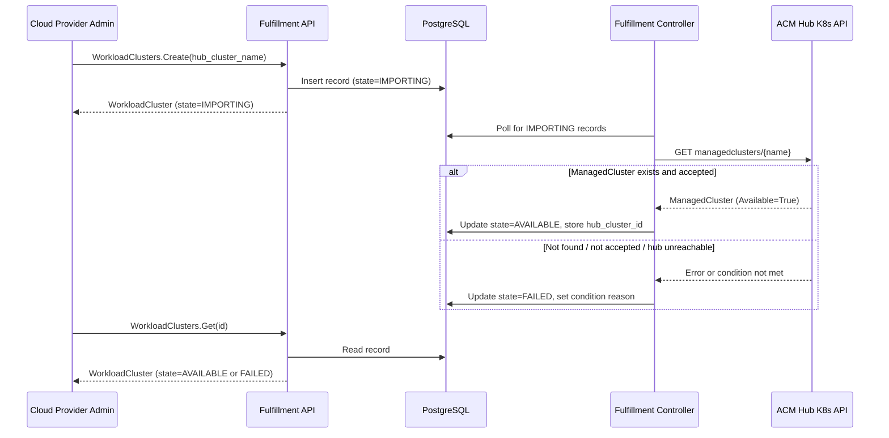
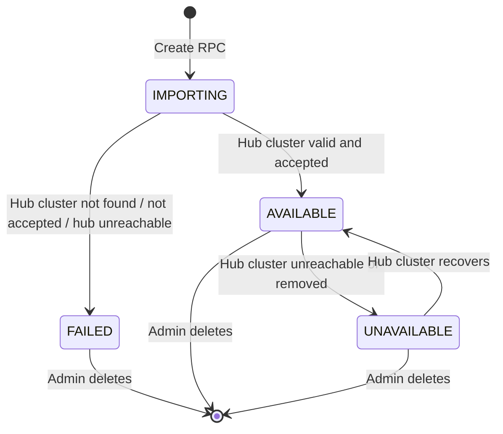

# Import Hub-Registered Clusters for AI Workloads

## Summary

This design introduces a new `WorkloadCluster` resource in the
fulfillment-service that allows Cloud Provider Admins to import ACM
hub-registered clusters into OSAC as targets for MaaS AI inference
workloads. Import is a registration operation that creates a persistent
database record referencing a ManagedCluster on the ACM hub; it does not
provision infrastructure or create Kubernetes CRDs on the operator. See
[PRD](prd.md) for detailed requirements.

## Motivation

OSAC currently represents clusters only through the CaaS `Cluster`
resource, which is tightly coupled to HyperShift-based provisioning via
ClusterOrder CRDs, AAP jobs, and BareMetalInstanceType hardware
profiles. Cloud providers that already manage AI Grid clusters through
ACM have no way to register them in OSAC so their capacity can
participate in MaaS AI workload flows. Providers must either provision
separate clusters through CaaS or operate AI capacity outside OSAC's
tenant model, fragmenting tenant controls and limiting infrastructure
reuse.

The existing `Cluster` resource cannot represent imported clusters
without invasive changes: its required fields (`template`, `node_sets`
with `BareMetalInstanceType` references), provisioning-specific status
fields (MetalLB VIPs, HostedCluster references), and operator
integration (ClusterOrder CRD, AAP provisioning jobs) are all
inapplicable to externally managed clusters. A new resource type
provides clean separation between provisioned and imported cluster
lifecycles.

### Goals

- Introduce a new `WorkloadCluster` resource type with its own proto,
  gRPC service, database table, and fulfillment controller, independent
  of the existing CaaS `Cluster` resource and ClusterOrder CRD.
- Validate the referenced ACM ManagedCluster on the hub during import
  and prevent duplicate imports of the same physical cluster.
- Follow the existing OSAC resource patterns: standard object shape,
  public/private API split via CleanAPI, OPA-based authorization, and
  tenant-scoped metadata.
- Gate the WorkloadCluster service behind the `services.maas.enabled`
  flag per the OSAC-3046 per-service enablement model.
- Design the state model and data schema so that future enhancements
  (disconnect, readiness criteria, multi-tenant sharing) can be added
  without breaking changes.
- Define a forward-compatible workload role model on the
  `WorkloadCluster` resource so that additional roles (e.g., VMaaS)
  can be introduced in future increments without schema-breaking
  changes.
- Restrict all discovery and import operations to the Cloud Provider
  Admin role; tenant users and other roles must not be able to
  discover, list, or import WorkloadClusters.

### Non-Goals

- Provisioning new clusters or managing cluster lifecycle beyond import
  registration.
- Disconnecting imported clusters from OSAC (deferred per Locked D5).
- Defining or enforcing AI workload readiness criteria (deferred per
  Locked D3).
- Managing ACM/Praxis policies, cluster labels, or customer GitOps
  workflows for AI Grid configuration.
- Using imported clusters for VMaaS, CaaS, or BMaaS workloads in this
  increment. The `WorkloadRole` enum is extensible by design so that
  VMaaS and other workload roles can be added in a future increment
  without breaking changes; however, this design does not implement or
  validate any role other than MaaS AI inference.
- Multi-tenant sharing of imported clusters (see Open Question 9.1).

## Proposal

A new `WorkloadCluster` resource represents an imported hub-registered
cluster in the fulfillment-service. Cloud Provider Admins import a
cluster by calling `WorkloadClusters.Create` with the ACM
ManagedCluster name. The fulfillment-service validates the cluster
exists on the hub, creates a database record, and exposes the result
through the standard OSAC API (gRPC, REST, CLI, UI).

The resource follows the standard OSAC object shape (`id`, `Metadata`,
`WorkloadClusterSpec`, `WorkloadClusterStatus`). The spec captures the
import identity (hub cluster reference); the status tracks import state
and hub availability. No Kubernetes CRD is created on the operator —
the fulfillment controller validates the hub cluster directly via the
hub's Kubernetes API.

### Workflow Description

#### Import a Hub-Registered Cluster

**Starting state:** A Cloud Provider Admin has an ACM hub with one or
more registered ManagedClusters. The MaaS service is enabled in the
OSAC deployment.

**Authorization:** Only Cloud Provider Admins may call the Create RPC.
All other roles (Tenant Admin, Tenant User) receive `PermissionDenied`.

1. Cloud Provider Admin calls `WorkloadClusters.Create` via the OSAC
   API (gRPC, REST, CLI, or UI), providing the ACM ManagedCluster
   name, the workload role (`MAAS_AI_INFERENCE`), and an optional
   OSAC display name.
2. The fulfillment-service validates the request:
   - The ManagedCluster name must be non-empty.
   - No existing WorkloadCluster in the same tenant references the
     same hub cluster name — otherwise return `AlreadyExists`.
3. The fulfillment-service creates a database record with state
   `WORKLOAD_CLUSTER_STATE_IMPORTING`.
4. The fulfillment controller (reconciler) validates the hub cluster:
   - Queries `managedclusters` on the ACM hub via the hub Kubernetes
     API.
   - Confirms the ManagedCluster exists and has condition
     `HubAcceptedManagedCluster` = True.
   - Stores the cluster's `id.k8s.io` claim as `hub_cluster_id`
     (private field) for stable identity.
5. On success, the controller updates state to
   `WORKLOAD_CLUSTER_STATE_AVAILABLE` and sets the `Imported`
   condition to True. Note: AVAILABLE indicates import validation
   succeeded, not workload readiness — readiness criteria are
   deferred per Locked D3.
6. On failure (ManagedCluster not found, not accepted, or hub
   unreachable), the controller updates state to
   `WORKLOAD_CLUSTER_STATE_FAILED` and sets the `Failed` condition
   to True with a predefined reason code and descriptive message.
   No retry or recovery action is required [Locked: D2].
   The `Failed` condition is the canonical import-failure indicator;
   all API, CLI, UI, and test consumers read this condition to
   determine failure cause.
7. Cloud Provider Admin observes the import outcome through the API,
   CLI, or UI.



The diagram shows the import flow from the Cloud Provider Admin's
perspective. The fulfillment controller runs asynchronously; the admin
observes the final state by polling or watching the resource.

#### State Machine



AVAILABLE indicates import validation succeeded and the hub cluster is
reachable — it does not represent workload readiness (deferred per
Locked D3). UNAVAILABLE signals that the MaaS placement layer should
not schedule new workloads to this cluster.

#### Discover and View Import Outcome

**Starting state:** A WorkloadCluster has been created.

**Authorization:** Only Cloud Provider Admins may call the Get and
List RPCs. Tenant Admins, Tenant Users, and all other roles receive
`PermissionDenied`. Discovery of WorkloadCluster resources is
exclusively a Cloud Provider Admin operation.

1. Cloud Provider Admin calls `WorkloadClusters.Get` or
   `WorkloadClusters.List` via API, CLI, or UI.
2. The response includes the current state, conditions, and hub
   cluster metadata.
3. If the import failed, the `Failed` condition's `reason` and
   `message` fields describe the cause.

### API Extensions

This design adds one new gRPC service:

- **`WorkloadClusters`** — a new service in the fulfillment-service
  with List, Get, Create, Update, Delete, and Signal RPCs following the
  standard OSAC service pattern.
- The service is registered conditionally based on the
  `--enable-maas` flag per the OSAC-3046 pattern. When MaaS is
  disabled, calls return `codes.Unavailable` with a descriptive
  message.
- No existing resources or services are modified.

## UX Alignment

No `@temp-api` file exists at
`osac-ux/libs/ui-components/src/api/v1/workload_cluster.ts`. The UI
will be built from the generated protobuf TypeScript types after the
proto is merged. No pre-existing UI field mapping or deviation to
reconcile.

### Implementation Details/Notes/Constraints

#### Proto Schema

**`proto/private/osac/private/v1/workload_cluster_type.proto`**

```protobuf
message WorkloadCluster {
  string id = 1;
  Metadata metadata = 2;
  WorkloadClusterSpec spec = 3;
  WorkloadClusterStatus status = 4;
}

enum WorkloadRole {
  WORKLOAD_ROLE_UNSPECIFIED = 0;
  // MaaS AI inference workloads. Only supported role in this increment.
  WORKLOAD_ROLE_MAAS_AI_INFERENCE = 1;
  // Reserved for future use — not accepted by validation in this
  // increment. Listed here to illustrate extensibility; the proto
  // enum is additive-only per proto3 compatibility rules.
  // WORKLOAD_ROLE_VMAAS = 2;
}

message WorkloadClusterSpec {
  // Name of the ManagedCluster on the ACM hub.
  // Immutable after creation. Required.
  string hub_cluster_name = 1;

  // The workload role this cluster serves.
  // Immutable after creation. Required.
  // Validation: the Create handler rejects any value other than
  // WORKLOAD_ROLE_MAAS_AI_INFERENCE in this increment, returning
  // InvalidArgument. Future increments add accepted values to the
  // validation allow-list without a schema migration.
  WorkloadRole workload_role = 2;
}

message WorkloadClusterStatus {
  // Overall state of the workload cluster.
  WorkloadClusterState state = 1;

  // Conditions describing the status in detail.
  repeated WorkloadClusterCondition conditions = 2;

  // Kubernetes version reported by the ManagedCluster.
  string kubernetes_version = 3;

  // Platform reported by the ManagedCluster
  // (e.g., "AWS", "BareMetal").
  string platform = 4;

  // Timestamp when the cluster entered its current state.
  optional google.protobuf.Timestamp state_transition_time = 5;

  // Stable cluster UUID from the ManagedCluster's
  // id.k8s.io claim. Used for duplicate detection.
  string hub_cluster_id = 6
      [(cleanapi.field).private = true];
}

enum WorkloadClusterState {
  WORKLOAD_CLUSTER_STATE_UNSPECIFIED = 0;
  WORKLOAD_CLUSTER_STATE_IMPORTING = 1;
  WORKLOAD_CLUSTER_STATE_AVAILABLE = 2;
  WORKLOAD_CLUSTER_STATE_UNAVAILABLE = 3;
  WORKLOAD_CLUSTER_STATE_FAILED = 4;
}

message WorkloadClusterCondition {
  WorkloadClusterConditionType type = 1;
  bool status = 2;
  string reason = 3;
  string message = 4;
  google.protobuf.Timestamp last_transition_time = 5;
}

enum WorkloadClusterConditionType {
  WORKLOAD_CLUSTER_CONDITION_TYPE_UNSPECIFIED = 0;
  // Import validation succeeded.
  WORKLOAD_CLUSTER_CONDITION_TYPE_IMPORTED = 1;
  // ManagedCluster is reachable on the hub.
  WORKLOAD_CLUSTER_CONDITION_TYPE_HUB_REACHABLE = 2;
  // Import validation failed.
  WORKLOAD_CLUSTER_CONDITION_TYPE_FAILED = 3;
}
```

**`proto/private/osac/private/v1/workload_clusters_service.proto`**

Standard service following the OSAC pattern: List, Get, Create, Update,
Delete, Signal (private). Create is the public import operation — unlike
`Clusters.Create` which is system-internal, `WorkloadClusters.Create`
is user-facing for Cloud Provider Admins.

HTTP route mapping: `option (cleanapi.file).http_route_prefix_map =
"private:fulfillment"` rewrites `/api/private/v1/workload-clusters` to
`/api/fulfillment/v1/workload-clusters` in the public API.

#### Database Schema

New migration creates the `workload_clusters` table following the
standard OSAC pattern:

```sql
CREATE TABLE workload_clusters (
  id TEXT PRIMARY KEY,
  name TEXT,
  creation_timestamp TIMESTAMP,
  deletion_timestamp TIMESTAMP,
  finalizers TEXT[],
  creator TEXT,
  tenant TEXT,
  labels JSONB,
  annotations JSONB,
  data JSONB,
  version INTEGER
);

CREATE TABLE archived_workload_clusters (
  LIKE workload_clusters INCLUDING ALL,
  archival_timestamp TIMESTAMP DEFAULT NOW()
);

CREATE INDEX idx_workload_clusters_name
  ON workload_clusters (name);
CREATE INDEX idx_workload_clusters_tenant
  ON workload_clusters (tenant);
CREATE INDEX idx_workload_clusters_labels
  ON workload_clusters USING GIN (labels);

-- Enforce tenant-scoped hub-cluster uniqueness atomically.
-- The expression index extracts hub_cluster_name from the JSONB data
-- column where the generic server stores spec fields.
CREATE UNIQUE INDEX uq_workload_clusters_tenant_hub
  ON workload_clusters (tenant, (data->>'hub_cluster_name'))
  WHERE deletion_timestamp IS NULL;
```

Name uniqueness is enforced per (tenant, project, resource type) by the
generic server layer.

The migration must persist the effective `hub_cluster_name` value in a
uniquely indexable field and enforce a database unique constraint (or
unique expression index) on `(tenant, hub_cluster_name)` for
non-deleted records. The DAO must translate a constraint-violation
error from this index into an `AlreadyExists` gRPC status. This
constraint is the authoritative concurrency guard — the application-
level lookup described below is an early error check only.

#### Duplicate Detection

The fulfillment-service Create handler performs two checks:

1. **Name uniqueness** — standard OSAC check, returns `AlreadyExists`
   if a WorkloadCluster with the same name exists in the same tenant
   and project.
2. **Hub cluster identity uniqueness** — queries existing
   WorkloadClusters in the same tenant for a matching
   `hub_cluster_name` in the spec. Returns `AlreadyExists` with
   message "a workload cluster referencing hub cluster '{name}'
   already exists" if found.

The application-level lookup (check 2) is an early error check that
provides a user-friendly error message. It is **not** the concurrency
guard. Two concurrent `Create` requests with different OSAC names but
the same `hub_cluster_name` may both pass the lookup; the database
unique constraint catches the second insert and the DAO translates the
violation to `AlreadyExists`. This ensures exactly one import succeeds
under concurrent requests, satisfying FR-4.

#### Fulfillment Controller

A new `workload_cluster_controller.go` in
`fulfillment-service/internal/controllers/` follows the existing
reconciler pattern:

1. Polls `WorkloadClusters.List` via the private API, filtering for
   records that need reconciliation (state = IMPORTING, or periodic
   health check for AVAILABLE records).
2. For IMPORTING records: queries the ACM hub K8s API for the
   ManagedCluster, validates conditions, stores identity claims,
   transitions to AVAILABLE or FAILED.
3. For AVAILABLE records: periodically checks the ManagedCluster's
   `ManagedClusterConditionAvailable` condition. If the cluster
   becomes unreachable, transitions to UNAVAILABLE. If it recovers,
   transitions back to AVAILABLE.
4. Uses Signal RPC to notify the fulfillment-service of state
   changes.

The controller connects to the hub using the hub kubeconfig mounted
from the `hub-kubeconfig` Secret in the fulfillment-service namespace.
This is the same credential the osac-operator uses for ClusterOrder
management, provisioned during OSAC installation via Helm values. If
the Secret is missing or the kubeconfig is invalid, the controller
logs an error at startup and all import validations fail with
`HubUnreachable` until the credential is corrected.

### Security Considerations

The WorkloadCluster resource inherits the existing OSAC security model:
JWT authentication, OPA authorization, tenant-scoped database queries.

**New OPA permissions:**
- `workload_cluster:list` — Cloud Provider Admin
- `workload_cluster:get` — Cloud Provider Admin
- `workload_cluster:create` — Cloud Provider Admin
- `workload_cluster:update` — Cloud Provider Admin
- `workload_cluster:delete` — Cloud Provider Admin

Per Locked D6, imported cluster details are visible only to Cloud
Provider Admins. Tenant Admins and Tenant Users access AI capacity
through MaaS workload flows; they do not see WorkloadCluster resources
directly. The OPA policies enforce this by granting `workload_cluster:*`
permissions only to the Cloud Provider Admin role.

**Input validation:**
- `hub_cluster_name` validated as non-empty string matching DNS label
  format (RFC 1123, consistent with ManagedCluster naming).
- No user-supplied data is forwarded to the hub API without validation.

**Hub API access:** The fulfillment controller uses a read-only
kubeconfig for the hub (only `get`/`list`/`watch` on
`managedclusters`). No write operations are performed on the hub or on
managed clusters.

**Failure message exposure:** Condition reason and message fields on
failed imports use only predefined reason codes (`HubClusterNotFound`,
`HubClusterNotAccepted`, `HubUnreachable`) and generic cause
descriptions. These fields are visible only to Cloud Provider Admins
per Locked D6.

**Logging redaction policy:** All structured log entries emitted by the
WorkloadCluster service and controller must comply with the following
allow-list / deny-list policy:

- **Allowed fields:** opaque OSAC resource ID (`workload_cluster_id`),
  `workload_role` enum value, state transition (`from_state`,
  `to_state`), predefined reason code, Prometheus metric labels,
  request latency, and allow-listed error categories (`hub_unreachable`,
  `hub_cluster_not_found`, `hub_cluster_not_accepted`,
  `constraint_violation`, `invalid_argument`).
- **Denied fields (must never appear in any log level):** tenant
  identifiers (tenant ID, tenant name, organization ID),
  ManagedCluster names, `hub_cluster_name` spec values, credentials,
  kubeconfig content, raw hub API error bodies, stack traces, hub
  URLs, internal network addresses, and bearer tokens.
- **Format:** JSON structured logging via the project's standard
  `slog` configuration. Each log entry must include `component`,
  `operation`, and `request_id` fields.
- **Validation:** Unit tests must assert that controller log output
  for each failure mode contains only allowed fields. Integration
  tests must assert that no denied field appears in the combined
  service log output for a complete import cycle.

### Failure Handling and Recovery

| Failure Mode | What Happens | Recovery | User Observes |
|---|---|---|---|
| ManagedCluster not found on hub | Controller sets FAILED state, `Failed` condition True with reason `HubClusterNotFound` | Admin can delete the failed WorkloadCluster and retry with a correct name | State=FAILED, `Failed` condition message: "ManagedCluster not found on the ACM hub" |
| ManagedCluster not accepted by hub | Controller sets FAILED state, `Failed` condition True with reason `HubClusterNotAccepted` | Admin resolves hub-side acceptance, deletes and reimports | State=FAILED, `Failed` condition message: "ManagedCluster exists but is not accepted by the hub" |
| Hub unreachable during import | Controller sets FAILED state, `Failed` condition True with reason `HubUnreachable` | Admin or infrastructure team restores hub connectivity; admin deletes and reimports | State=FAILED, `Failed` condition message: "Cannot reach ACM hub to validate cluster" |
| Hub becomes unreachable after import | Controller transitions AVAILABLE to UNAVAILABLE, sets `HubReachable` condition False | Automatic: controller retries periodically; transitions back to AVAILABLE when hub is reachable and ManagedCluster Available | State=UNAVAILABLE, condition message: "ManagedCluster is no longer reachable on the ACM hub" |
| ManagedCluster removed from hub after import | Controller transitions to UNAVAILABLE with reason `HubClusterRemoved` | Admin deletes the WorkloadCluster | State=UNAVAILABLE, condition message: "ManagedCluster '{name}' no longer exists on the ACM hub" |
| Database write failure during import | Create RPC returns an error to the caller | Standard gRPC retry by client | gRPC error (e.g., `Internal`) |
| Duplicate import attempt | Create RPC returns `AlreadyExists` | No action needed — the duplicate is rejected; admin can verify the existing record via Get/List | `AlreadyExists` error with descriptive message |

All controller operations are idempotent. If the controller restarts
mid-reconciliation, it re-reads the current state from the database
and resumes from the last persisted state.

### RBAC / Tenancy

The WorkloadCluster resource uses the standard OSAC tenant isolation
metadata:

- `metadata.tenant` — Set automatically from the authenticated
  caller's tenant context. All database queries are filtered by
  tenant.
- `osac.openshift.io/tenant` annotation — Applied by the generic
  server layer.
- `osac.openshift.io/owner-reference` annotation — Applied by the
  generic server layer, linking the resource to the creating user's
  identity for audit and ownership tracking.

OPA policies restrict all WorkloadCluster operations — including
discovery (List), inspection (Get), import (Create), modification
(Update), and removal (Delete) — to the Cloud Provider Admin role.
Tenant Admins, Tenant Users, and all other roles receive
`PermissionDenied` for every WorkloadCluster RPC. They access
imported cluster capacity indirectly through MaaS AI workload flows
and never observe WorkloadCluster resources in any API, CLI, or UI
surface.

**Tenant allocation model [Unresolved]:** Whether an imported
WorkloadCluster's capacity is available to AI workloads from the
owning tenant only (single-tenant) or from multiple tenants
(multi-tenant) is unresolved (see Open Question 9.1). The current
design uses single-tenant ownership as the default: the
WorkloadCluster is scoped to the importing admin's tenant. If
multi-tenant sharing is needed, a future enhancement can add a sharing
mechanism (e.g., a `shared` flag or a tenant-assignment list) without
schema changes.

### Observability and Monitoring

**Metrics (Prometheus):**

| Metric | Type | Labels | Description |
|---|---|---|---|
| `osac_workload_cluster_import_total` | Counter | `result` (success, failure, duplicate) | Total import attempts |
| `osac_workload_cluster_import_duration_seconds` | Histogram | — | Import operation latency (create to final state) |
| `osac_workload_cluster_state` | Gauge | `state` | Current count of WorkloadClusters by state |
| `osac_workload_cluster_hub_check_total` | Counter | `result` (success, failure) | Hub availability check attempts |

**Kubernetes Events:**

| Event | Type | Reason | When |
|---|---|---|---|
| Import started | Normal | `ImportStarted` | WorkloadCluster created |
| Import succeeded | Normal | `ImportSucceeded` | State → AVAILABLE |
| Import failed | Warning | `ImportFailed` | State → FAILED |
| Hub unreachable | Warning | `HubUnreachable` | State → UNAVAILABLE |
| Hub recovered | Normal | `HubRecovered` | State UNAVAILABLE → AVAILABLE |

**Structured logging:** Import operations are logged at INFO level
using only opaque OSAC resource IDs, the `workload_role` enum value,
state transitions, and predefined reason codes. Hub connectivity
failures are logged at WARN level with the allow-listed error category
only — no tenant identifiers, ManagedCluster names, credentials,
kubeconfig content, raw hub errors, stack traces, URLs, or internal
addresses may appear in any log entry. See the logging redaction
policy in §Security Considerations for the full allow-list/deny-list
and required test coverage.

### Risks and Mitigations

| Risk | Mitigation |
|---|---|
| Hub API latency slows import validation | Controller runs asynchronously; Create RPC returns immediately with IMPORTING state. Hub validation is non-blocking. |
| Hub cluster removed while OSAC workloads are active | UNAVAILABLE state signals to MaaS placement that the cluster should not receive new workloads. Existing workload handling is a MaaS concern, not a WorkloadCluster concern. |
| Large number of imported clusters overwhelms controller | Controller uses standard reconciler polling with configurable interval. Rate limiting can be added if needed. |
| ACM API version changes break hub queries | The `cluster.open-cluster-management.io/v1` ManagedCluster API is GA and stable. Pin the API version in the controller client. |

### Extensibility / Future-Proofing

The `WorkloadRole` enum on `WorkloadClusterSpec` provides the primary
extensibility point for future workload types:

- **Adding a new role (e.g., VMaaS):** A future increment adds
  `WORKLOAD_ROLE_VMAAS = 2` to the `WorkloadRole` proto enum and
  updates the Create handler's validation allow-list. No database
  migration, schema change, or proto field addition is required. The
  existing `workload_role` column in the `data` JSONB is already
  persisted — only the accepted-value check changes.
- **Role-specific validation:** Each role may define its own hub
  validation requirements (e.g., VMaaS might require different
  ManagedCluster conditions). The fulfillment controller dispatches
  validation to a role-specific handler. This increment implements
  only the `MAAS_AI_INFERENCE` handler.
- **Role-specific capabilities:** If future roles need additional
  spec fields (e.g., GPU profiles for VMaaS), these are added as new
  proto fields on `WorkloadClusterSpec` with field numbers above the
  current range. Existing clients that do not set the new fields
  continue to work — proto3 treats absent fields as their default
  values.
- **Versioning behavior:** The `v1` WorkloadCluster API is
  additive-only. New roles and fields are backwards-compatible
  additions. If a future change requires non-additive modification
  (removing a role, changing semantics), a `v2` API version is
  introduced per OSAC API versioning policy.

### Drawbacks

Introducing a separate `WorkloadCluster` resource type adds a new
concept to the OSAC API alongside the existing `Cluster` resource. Users
must understand the distinction: `Cluster` is for CaaS-provisioned
clusters, `WorkloadCluster` is for imported clusters used by MaaS.

This trade-off is preferable to overloading `Cluster` with conditional
behavior based on an origin field, which would require every existing
consumer (operator, feedback controller, UI, CLI, metering) to branch
on cluster type and would risk regressions in the mature CaaS
provisioning flow.

## Alternatives (Not Implemented)

### Alternative 1: Extend `Cluster` with an Origin Field

Add an `origin` enum (`PROVISIONED`, `IMPORTED`) to `ClusterSpec` and
make provisioning-specific fields (`template`, `node_sets`) optional
when origin is `IMPORTED`.

**Pros:**
- Single resource type for all clusters.
- Existing `Clusters` service and UI views might need fewer changes.

**Cons:**
- Proto validation rules become conditional, increasing complexity.
- The fulfillment controller must branch on origin to avoid creating
  ClusterOrder CRDs for imported clusters.
- Every consumer (operator, feedback controller, CLI, UI, metering)
  must handle both origins, creating regression risk in the CaaS flow.
- Status fields (MetalLB VIPs, HostedCluster references, provisioning
  jobs) are meaningless for imported clusters, confusing API consumers.

**Rejection reason:** The lifecycle, state machine, and operator
integration of provisioned vs. imported clusters are fundamentally
different. A separate resource type provides cleaner separation with
lower regression risk.

### Alternative 2: New Operator CRD for Imported Clusters

Create a `WorkloadClusterOrder` CRD in the osac-operator, mirroring
the ClusterOrder pattern.

**Pros:**
- Consistent with the existing Cluster → ClusterOrder pattern.
- Operator has direct hub access for validation.

**Cons:**
- Import is a registration operation, not a provisioning operation.
  No AAP jobs, HostedClusters, or NodePools are needed.
- Adding a CRD for a database registration operation introduces
  unnecessary Kubernetes controller complexity.
- The operator would need to Signal back to the fulfillment-service
  for a simple validation, adding round-trip latency.

**Rejection reason:** The fulfillment controller can validate the hub
cluster directly, keeping the import path simpler. A CRD is warranted
only when Kubernetes-level reconciliation (e.g., creating child
resources) is needed, which is not the case for import.

### Alternative 3: Do Nothing

Rely on external tooling or manual database entries to register
imported clusters.

**Pros:** No OSAC changes needed.

**Cons:** No API visibility, no tenant isolation, no integration with
MaaS workload flows, no observability. Violates the PRD requirements.

**Rejection reason:** The PRD explicitly requires API, CLI, and UI
visibility for imported clusters with tenant isolation.

## Open Questions

### 9.1 Tenant Allocation Model

Should imported WorkloadClusters serve AI workloads from the owning
tenant only (single-tenant) or from multiple tenants (multi-tenant)?

- **Owner:** OSAC-MaaS team
- **Impact:** Affects OPA policies, MaaS placement queries, and
  whether a `shared` flag or tenant-assignment mechanism is needed on
  the WorkloadCluster resource. The current design defaults to
  single-tenant ownership. Multi-tenant sharing can be added via a
  future schema extension without breaking changes.

### 9.2 Jira Definition of Done — Disconnect

The Jira OSAC-6488 Definition of Done includes a disconnect capability
that was removed from the PRD during review (Locked D5). Should the
Jira DoD be updated to match the merged PRD?

- **Owner:** Eran Cohen (Feature owner)
- **Impact:** No impact on this design (disconnect is excluded per the
  merged PRD). The DoD update is a Jira hygiene action.

### 9.3 MaaS Placement Integration

How do MaaS AI workload flows discover and select WorkloadClusters for
placement? Does MaaS query the WorkloadClusters service directly, or
does it delegate to ACM Placement resources?

- **Owner:** OSAC-MaaS team
- **Impact:** Affects whether the WorkloadCluster service needs
  additional query filters or labels for placement. The current design
  exposes a standard List RPC with CEL filter support, which is
  sufficient for direct queries. ACM Placement integration would be a
  separate enhancement.

## Test Plan

### Requirement Traceability

Test scenarios below reference functional requirement IDs derived from
the [PRD](prd.md) In Scope items:

| ID | PRD In Scope Item | Summary |
|---|---|---|
| FR-1 | Import clusters through OSAC UI, CLI, and API | Create/import a hub-registered cluster as a WorkloadCluster |
| FR-2 | See import outcome through the UI, CLI, and API | View import state, conditions, and metadata |
| FR-3 | Imported details visible only to Cloud Provider Admins | Authorization and tenant-scoped visibility |
| FR-4 | Import failures show the cause; no recovery action required | Failure handling, duplicate detection, and error reporting |
| FR-5 | AI workloads can use workload clusters preserving tenant isolation | Tenant isolation enforced in database queries and OPA policies |

### Unit Tests

**Location:** `fulfillment-service/internal/servers/` (Ginkgo/Gomega)

| Scenario | Requirement | Expected Behavior |
|---|---|---|
| Create with valid hub_cluster_name and MAAS_AI_INFERENCE role | FR-1 | Returns WorkloadCluster with state=IMPORTING |
| Create with empty hub_cluster_name | FR-1 | Returns InvalidArgument |
| Create with unsupported workload_role (e.g., UNSPECIFIED) | FR-1 | Returns InvalidArgument |
| Create with duplicate name in same tenant | FR-1, FR-4 | Returns AlreadyExists |
| Create with duplicate hub_cluster_name in same tenant | FR-1, FR-4 | Returns AlreadyExists with descriptive message |
| Concurrent duplicate hub_cluster_name imports | FR-4 | Exactly one succeeds; other returns AlreadyExists via DB constraint |
| Create with same hub_cluster_name in different tenant | FR-1 | Succeeds (tenants are isolated) |
| List returns only tenant-scoped results | FR-2, FR-3 | Only WorkloadClusters in the caller's tenant are returned |
| Get by ID | FR-2 | Returns the WorkloadCluster with current state and conditions |
| Update metadata.labels | FR-1 | Labels updated, version incremented |
| Update spec.hub_cluster_name | FR-1 | Returns InvalidArgument (immutable) |
| Delete a WorkloadCluster | — | Record marked for deletion, archived after finalizers clear |
| Signal triggers reconciliation | — | Signal RPC accepted, returns empty response |
| Private fields not in public API | FR-3 | `hub_cluster_id` absent from public proto response |
| MaaS disabled | — | All RPCs return Unavailable with descriptive message |

### Integration Tests

**Location:** `fulfillment-service/it/` (deployed service + database)

| Scenario | Requirement | Expected Behavior |
|---|---|---|
| Import end-to-end with mocked hub | FR-1, FR-2 | Create → controller validates → state transitions to AVAILABLE |
| Import with non-existent hub cluster | FR-4 | State transitions to FAILED with `HubClusterNotFound` reason |
| Import with unaccepted hub cluster | FR-4 | State transitions to FAILED with `HubClusterNotAccepted` reason |
| Import with unreachable hub | FR-4 | State transitions to FAILED with `HubUnreachable` reason |
| Hub availability monitoring | — | AVAILABLE → UNAVAILABLE when hub cluster becomes unreachable |
| Hub recovery monitoring | — | UNAVAILABLE → AVAILABLE when hub cluster recovers |
| Duplicate hub cluster detection | FR-4 | Second import of same hub cluster returns AlreadyExists |
| Tenant isolation in database queries | FR-3, FR-5 | Tenant A cannot see Tenant B's WorkloadClusters |

### API Tests

| Scenario | Requirement | Expected Behavior |
|---|---|---|
| REST POST /api/fulfillment/v1/workload-clusters | FR-1 | Creates WorkloadCluster via REST gateway |
| REST GET /api/fulfillment/v1/workload-clusters | FR-2 | Lists WorkloadClusters with filter/pagination |
| REST GET /api/fulfillment/v1/workload-clusters/{id} | FR-2 | Returns single WorkloadCluster |
| gRPC WorkloadClusters.Create | FR-1 | Creates WorkloadCluster via gRPC |
| Public API excludes private fields | FR-3 | hub_cluster_id not present in public responses |

### UI Tests

| Scenario | Requirement | Expected Behavior |
|---|---|---|
| Import form submits Create RPC | FR-1 | UI sends WorkloadClusters.Create with hub_cluster_name |
| Import outcome displayed | FR-2 | State and conditions rendered in detail view |
| Failure cause displayed | FR-4 | Failed condition reason and message shown to admin |
| WorkloadCluster list filtered by tenant | FR-3 | Only admin's tenant's clusters visible |

### Security and Isolation Tests

| Scenario | Requirement | Expected Behavior |
|---|---|---|
| Cloud Provider Admin can create WorkloadCluster | FR-1 | Create succeeds with proper JWT |
| Cloud Provider Admin can list (discover) WorkloadClusters | FR-2, FR-3 | List succeeds, returns only own tenant's clusters |
| Tenant Admin cannot create WorkloadCluster | FR-3 | Create returns PermissionDenied |
| Tenant Admin cannot list (discover) WorkloadClusters | FR-3 | List returns PermissionDenied |
| Tenant User cannot list WorkloadClusters | FR-3 | List returns PermissionDenied |
| Tenant User cannot get WorkloadCluster by ID | FR-3 | Get returns PermissionDenied |
| Cross-tenant access denied | FR-3, FR-5 | Admin in Tenant A cannot read Tenant B's WorkloadClusters |
| Unauthenticated request rejected | FR-3 | Returns Unauthenticated |

### Failure Tests

| Scenario | Requirement | Expected Behavior |
|---|---|---|
| Hub unreachable during import | FR-4 | State=FAILED, descriptive error message |
| Hub unreachable after import | — | State transitions AVAILABLE → UNAVAILABLE |
| Hub recovers after outage | — | State transitions UNAVAILABLE → AVAILABLE |
| Controller restart mid-import | FR-4 | Resumes from last persisted state, no duplicate records |
| Database unavailable during Create | FR-4 | Returns Internal error, no partial state |
| Concurrent duplicate imports (DB constraint) | FR-4 | Exactly one succeeds, others return AlreadyExists from DB constraint violation |

### E2E Tests

**Location:** `tests/e2e/` (pytest via osac-test-infra)

| Scenario | Requirement | Expected Behavior |
|---|---|---|
| Import hub-registered cluster via API | FR-1 | WorkloadCluster created with state=AVAILABLE |
| Verify import outcome via CLI (`osac workload-cluster list`) | FR-2 | Cluster appears in list output |
| Verify import outcome via CLI (`osac workload-cluster describe`) | FR-2 | Cluster details shown with state and conditions |
| Import non-existent cluster | FR-4 | Returns FAILED with descriptive cause |
| Verify tenant isolation | FR-3, FR-5 | Tenant Admin and Tenant User cannot see WorkloadCluster |
| Import same cluster twice | FR-4 | Second attempt returns AlreadyExists |
| Delete imported cluster | — | WorkloadCluster removed from list |
| Verify Tenant Admin cannot discover clusters via CLI | FR-3 | `osac workload-cluster list` returns PermissionDenied |

### Logging Redaction Tests

| Scenario | Expected Behavior |
|---|---|
| Import success — log output contains only allowed fields | Log entries include `workload_cluster_id`, `workload_role`, state transition, latency; no tenant ID, no ManagedCluster name, no hub URL |
| Import failure — log output redacts denied fields | Log entries include `workload_cluster_id`, reason code; no raw hub error body, no stack trace, no credentials, no kubeconfig content |
| Hub health check — log output redacts denied fields | Log entries include resource ID, error category; no internal addresses, no bearer tokens |

**Test infrastructure requirement:** E2E tests require an ACM hub with
at least one registered ManagedCluster in the test environment.

## Graduation Criteria

### Dev Preview → Tech Preview

- All unit, integration, and API tests in the test plan pass in CI.
- E2E import-and-verify scenario executes against a live ACM hub in
  the QE environment.
- Documentation (API reference, CLI help text, UI tooltips) is
  published.
- At least one cloud provider has imported a cluster in a staging
  environment and confirmed the workflow (import, view outcome,
  delete).

### Tech Preview → GA

- Zero P1/P2 open bugs against the WorkloadCluster resource for two
  consecutive sprints.
- Hub availability monitoring (AVAILABLE ↔ UNAVAILABLE transitions)
  validated in a long-running soak test (≥ 72 hours).
- Security review completed — OPA policies audited, logging redaction
  policy verified by QE, no denied fields found in collected logs.
- Tenant isolation penetration test passes — cross-tenant access
  denied for all RPCs.
- Rollout to at least one production-like environment with the
  `services.maas.enabled` gate verified for both enable and disable
  paths.

## Upgrade / Downgrade Strategy

This is a new API with no upgrade impact on existing resources.

**Upgrade:** The new `workload_clusters` database table is created by a
new numbered migration. Existing tables and data are not affected.

**Downgrade:** Requires deleting all WorkloadCluster instances before
reverting the migration. The `archived_workload_clusters` table and
active records must be dropped. No impact on existing `clusters` or
`cluster_orders` resources.

## Version Skew Strategy

No version skew concerns. This is a new resource type with no existing
consumers. The fulfillment-service (which hosts the WorkloadCluster
service and controller) is deployed as a single unit; there is no
cross-component version dependency for this resource.

If MaaS components begin consuming the WorkloadCluster API, version
skew between the fulfillment-service and MaaS components should be
handled via API versioning (the `v1` API is additive-only).

## Support Procedures

**Detecting failure modes:**

- Import stuck in IMPORTING state: check fulfillment controller logs
  for hub connectivity errors. Metric:
  `osac_workload_cluster_hub_check_total{result="failure"}` increasing.
- Clusters in UNAVAILABLE state: check
  `osac_workload_cluster_state{state="UNAVAILABLE"}` gauge. Inspect
  the `HubReachable` condition for the specific failure reason.
- Import failures: check `osac_workload_cluster_import_total{result=
  "failure"}` counter. Inspect the `Failed` condition on the
  WorkloadCluster for the cause.

**Disabling the feature:**

Set `services.maas.enabled: false` in the Helm values and run
`helm upgrade`. This unregisters the WorkloadCluster gRPC service and
REST endpoints. Existing WorkloadCluster records remain in the database
but are not queryable. Re-enabling MaaS restores access to existing
records.

**Consequences of disabling:**
- MaaS AI workload flows that depend on WorkloadClusters will fail to
  discover available capacity.
- Existing workloads already placed on imported clusters are not
  affected (placement is a separate concern).
- No impact on CaaS, VMaaS, or BMaaS services.

**Recovery:** The WorkloadCluster controller is stateless (all state is
in the database). Restarting the fulfillment-service controller process
resumes normal operation. No manual intervention is needed for recovery
from controller crashes.

## Infrastructure Needed

- **E2E test environment:** An ACM hub with at least one registered
  ManagedCluster for E2E testing of the import flow. This may require
  a dedicated test hub or integration with an existing ACM test
  environment.
- No new repositories, subprojects, or CI infrastructure changes are
  needed.

---

## Provenance

Revised: revise @ design 0.9.0 - 155e7d6, workspace design/OSAC-6488 @ 20a4993
Phases: draft, revise

<!-- ai-workflow-provenance:{"schema_version":1,"provenance_kind":"session","workflow":"design","workflow_version":"0.9.0","ai_workflows":"155e7d6","source_repo":"20a4993","source_repo_branch":"design/OSAC-6488","commits_behind_main":0,"commits_ahead_main":1,"main_ref":"main","phases":["draft","revise"],"authoring_modes":["skill"],"context_changed":false,"origin_untracked":false} -->
