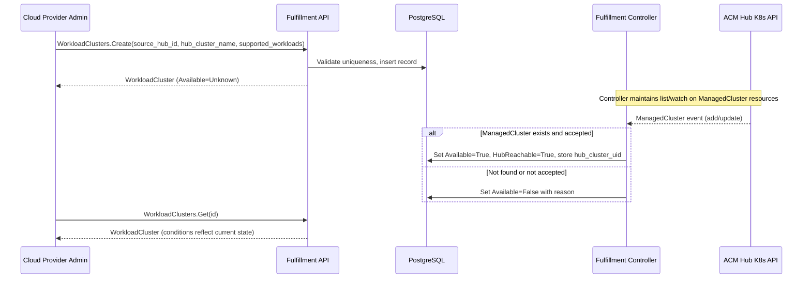

# Register Hub-Managed Clusters as Workload Clusters

| Field       | Value |
|-------------|-------|
| Author(s)   | Eran Cohen |
| Jira        | [OSAC-6488](https://redhat.atlassian.net/browse/OSAC-6488) |
| PRD         | [prd.md](prd.md) |
| Date        | 2026-10-21 |

# 1. Overview

This design introduces a provider-global `WorkloadCluster` resource in the
fulfillment-service that allows Cloud Provider Admins (CPAs) to register
ACM hub-managed clusters for use as OSAC workload targets. Each
WorkloadCluster is a canonical representation of one physical cluster
identified by a `(source_hub_id, hub_cluster_name)` pair with global
uniqueness. Registration is separate from entitlement: an optional
`allowed_tenants` field controls which tenants may consume capacity, while
the WorkloadCluster itself is a provider-level resource visible and
manageable only by CPAs. Tenant workloads consume capacity indirectly
through MaaS placement flows. See [PRD](prd.md) for detailed
requirements.

The design directly consumes OCM `ManagedCluster` CRDs on the Hub via
list/watch reconciliation, uses declarative conditions rather than an
imperative state machine, and defines an additive `supported_workloads`
capability list that starts with MaaS and accommodates future workload
types (e.g., VMaaS) without schema migration. A single ACM Hub is active
in this increment; the schema includes an immutable `source_hub_id` for
future multi-hub compatibility.

# 2. Goals and Non-Goals

## 2.1 Goals

- Define a provider-global canonical `WorkloadCluster` resource with
  global physical uniqueness enforced by `UNIQUE (source_hub_id,
  hub_cluster_name)` at the database layer, independent of the existing
  CaaS `Cluster` resource.
- Include an immutable `source_hub_id` field in the spec validated against
  the configured single Hub, with documented future multi-hub resolution
  path.
- Consume OCM `ManagedCluster` CRDs directly via list/watch on the Hub's
  Kubernetes API, with explicit trust, RBAC, version, and availability
  contracts documented.
- Use declarative conditions (`Available`, `HubReachable`) to represent
  cluster state, avoiding imperative import state machines or polling.
- Support an additive `supported_workloads` capability list starting with
  `maas`, enabling future `vmaas` coexistence without schema migration.
- Model registration as explicit external-infrastructure registration
  while preserving a canonical day-2 WorkloadCluster shape that future
  CaaS automatic provisioning can create.
- Restrict all WorkloadCluster discovery and management to the CPA role;
  tenant workloads consume capacity indirectly through MaaS placement.

## 2.2 Non-Goals

- Disconnecting registered clusters from OSAC (deferred per PRD Out of
  Scope).
- Introducing an anti-corruption adapter between OSAC and OCM CRDs.
  Direct CRD consumption is the chosen approach; extraction triggers are
  documented in §4.8.
- Active multi-hub routing or dynamic Hub discovery. This increment uses
  one configured Hub.
- Site-level or multi-cluster datacenter aggregation. Each WorkloadCluster
  maps 1:1 to a ManagedCluster leaf. Parent aggregate resources require a
  future PRD.
- CaaS automatic cluster provisioning. This increment covers external
  registration only; future CaaS integration creates WorkloadClusters
  automatically through the same resource shape.
- Managing ACM/Praxis policies, cluster labels, or customer GitOps
  workflows for AI Grid configuration.

# 3. Motivation / Background

OSAC currently represents clusters only through the CaaS `Cluster`
resource, which is tightly coupled to HyperShift-based provisioning via
ClusterOrder CRDs, AAP jobs, and BareMetalInstanceType hardware profiles.
Cloud providers that already manage AI Grid clusters through ACM have no
path to register them in OSAC so their capacity can participate in MaaS AI
workload flows. Providers must either provision separate clusters through
CaaS or operate AI capacity outside OSAC, fragmenting tenant controls and
limiting infrastructure reuse.

The existing `Cluster` resource cannot represent registered clusters: its
required fields (`template`, `node_sets` with `BareMetalInstanceType`
references), provisioning-specific status (MetalLB VIPs, HostedCluster
references), and operator integration (ClusterOrder CRD, AAP jobs) are
inapplicable to externally managed clusters. A separate resource type
provides clean separation between provisioned and registered cluster
lifecycles while sharing the canonical WorkloadCluster shape that future
provisioning modes can also target.

# 4. Design

## 4.1 Architecture

The `WorkloadCluster` resource lives entirely within the
fulfillment-service. No Kubernetes CRD is created on the OSAC operator
or on the target cluster. The fulfillment controller validates and
monitors the referenced `ManagedCluster` directly on the ACM Hub's
Kubernetes API.

**Components:**

1. **WorkloadCluster gRPC service** — List, Get, Create, Update, Delete,
   Signal RPCs in the fulfillment-service, registered conditionally behind
   the `--enable-maas` flag per the OSAC-3046 pattern.
2. **Fulfillment controller** — A reconciler in
   `fulfillment-service/internal/controllers/` that maintains a
   SharedInformer (list/watch) on `managedclusters.cluster.open-cluster-management.io/v1`
   on the Hub. On ManagedCluster events, it reconciles the corresponding
   WorkloadCluster's conditions.
3. **PostgreSQL database** — Standard OSAC table with a global uniqueness
   constraint on `(source_hub_id, hub_cluster_name)`.

**Registration flow:**



The diagram shows the registration and reconciliation flow. The Create RPC
returns immediately after database insertion. The controller independently
watches ManagedCluster resources on the Hub and updates conditions as the
cluster's state changes. This is a declarative model: conditions always
reflect the current observed state of the ManagedCluster, not the history
of a one-time import operation. The CPA observes the outcome by reading
the resource at any time.

**Direct OCM CRD consumption:** The fulfillment controller directly
consumes `ManagedCluster` CRDs from the Hub's Kubernetes API without an
intermediate anti-corruption adapter. This follows existing OSAC patterns
for external CRD consumption. The trust contract is:

| Dependency | Contract |
|---|---|
| API group | `cluster.open-cluster-management.io/v1` (GA, stable) |
| RBAC | Read-only: `get`, `list`, `watch` on `managedclusters` |
| Required conditions | `HubAcceptedManagedCluster`, `ManagedClusterConditionAvailable` |
| Required claims | `id.k8s.io` ClusterClaim for stable UID |
| Availability | Hub API must be reachable; transient failures are tolerated via watch reconnect |
| Version pinning | Client pins `cluster.open-cluster-management.io/v1`; version bumps require controller update |

**Extraction triggers** for introducing an adapter layer in the future:
- OCM deprecates the `v1` ManagedCluster API with a breaking successor
- A second Hub vendor with a different CRD schema must be supported
- The consumed CRD surface exceeds the current read-only contract (e.g.,
  write operations become necessary)

**1:1 ManagedCluster leaf mapping:** Each WorkloadCluster maps to exactly
one ManagedCluster on one Hub. Site-level or multi-cluster datacenter
aggregation (grouping multiple ManagedClusters under a parent resource)
is out of scope and requires a future parent aggregate PRD.

## 4.2 Data Model / Schema Changes

New migration creates the `workload_clusters` table. This is a
provider-level resource with no `tenant` column — entitlement is managed
through the `allowed_tenants` field in the spec JSONB.

```sql
CREATE TABLE workload_clusters (
  id TEXT PRIMARY KEY,
  name TEXT,
  creation_timestamp TIMESTAMP,
  deletion_timestamp TIMESTAMP,
  finalizers TEXT[],
  creator TEXT,
  labels JSONB,
  annotations JSONB,
  data JSONB,
  version INTEGER
);

CREATE TABLE archived_workload_clusters (
  LIKE workload_clusters INCLUDING ALL,
  archival_timestamp TIMESTAMP DEFAULT NOW()
);

CREATE INDEX idx_workload_clusters_name
  ON workload_clusters (name);
CREATE INDEX idx_workload_clusters_labels
  ON workload_clusters USING GIN (labels);

-- Global physical uniqueness: one canonical record per physical cluster.
-- Enforces that no two non-deleted WorkloadClusters reference the same
-- ManagedCluster on the same Hub.
CREATE UNIQUE INDEX uq_workload_clusters_hub_identity
  ON workload_clusters (
    (data->>'source_hub_id'),
    (data->>'hub_cluster_name')
  )
  WHERE deletion_timestamp IS NULL;
```

The `uq_workload_clusters_hub_identity` index is the authoritative
concurrency guard for physical uniqueness. The DAO translates a
constraint-violation error from this index into an `AlreadyExists` gRPC
status. The application-level lookup described in §4.3 is an early error
check that provides user-friendly messages but is not the concurrency
guard.

**Provider-global generic server adaptation:** The OSAC generic server
layer normally scopes resources by tenant (tenant column, tenant filter
in List/Get, `(tenant, project, resource_type, name)` uniqueness). Because
WorkloadCluster is a provider-level resource with no tenant column, the
following adaptations are required:

- **DAO:** The WorkloadCluster DAO must omit tenant filtering from List
  and Get queries. Name uniqueness is enforced globally per resource type,
  not per tenant/project.
- **OPA:** The WorkloadCluster authorization policy must evaluate CPA role
  membership without requiring a tenant context in the request. All five
  permissions (`workload_cluster:{list,get,create,update,delete}`) are
  granted only to the CPA role.
- **Generic server registration:** The WorkloadCluster service must be
  registered as a provider-level resource so the generic server layer
  bypasses tenant scoping.

These adaptations match the approach used for other provider-level
resources (e.g., the Tenant resource itself is managed by admins, not
scoped to a tenant).

**Post-validation immutable UID:** After the controller first validates
the ManagedCluster, it extracts the `id.k8s.io` ClusterClaim and stores
it as `hub_cluster_uid` in the status JSONB. This UID is immutable after
first write — if the controller detects a different UID for the same
`hub_cluster_name`, it sets `Available=False` with reason
`ClusterIdentityMismatch`, indicating the name now points to a different
physical cluster and administrative action is required.

## 4.3 API Changes

### Proto Schema

**`proto/private/osac/private/v1/workload_cluster_type.proto`**

```protobuf
message WorkloadCluster {
  string id = 1;
  Metadata metadata = 2;
  WorkloadClusterSpec spec = 3;
  WorkloadClusterStatus status = 4;
}

message WorkloadClusterSpec {
  // Identifier of the ACM Hub where the ManagedCluster is registered.
  // Immutable after creation. Required.
  // Validated against the fulfillment-service's configured Hub identity.
  // Future increments may support multiple Hubs with dynamic routing;
  // the schema supports this without migration.
  string source_hub_id = 1;

  // Name of the ManagedCluster resource on the Hub.
  // Immutable after creation. Required.
  // Together with source_hub_id, forms the globally unique physical
  // identity of this cluster.
  string hub_cluster_name = 2;

  // Additive list of workload capabilities this cluster supports.
  // At least one value required. Known values: "maas".
  // Unknown values are rejected with InvalidArgument.
  // Future values (e.g., "vmaas") are added to the validation
  // allow-list without schema migration.
  repeated string supported_workloads = 3;

  // Tenant IDs permitted to consume capacity from this cluster.
  // Empty or unset: provider-owned shared pool available to all tenants.
  // Populated: only listed tenants may consume capacity through
  // MaaS placement. Mutable by CPA.
  repeated string allowed_tenants = 4;
}

message WorkloadClusterStatus {
  // Conditions describing the current observed state.
  // No state enum — conditions are the canonical status representation.
  repeated WorkloadClusterCondition conditions = 1;

  // Stable cluster UUID from the ManagedCluster's id.k8s.io
  // ClusterClaim. Set by the controller after first successful
  // validation. Immutable after first write. Used for physical
  // identity verification.
  string hub_cluster_uid = 2
      [(cleanapi.field).private = true];
}

message WorkloadClusterCondition {
  // Condition type.
  string type = 1;
  // Condition status: "True", "False", or "Unknown".
  string status = 2;
  // Machine-readable reason code (CamelCase).
  string reason = 3;
  // Human-readable message.
  string message = 4;
  // Timestamp of last status change.
  google.protobuf.Timestamp last_transition_time = 5;
}
```

**Condition types and semantics:**

| Condition | True | False | Unknown |
|---|---|---|---|
| `Available` | ManagedCluster exists on Hub, is accepted, and Hub is reachable. Cluster is eligible for workload placement. | ManagedCluster not found, not accepted, or identity mismatch. Cluster is not eligible for placement. | Initial state after Create; controller has not yet reconciled. |
| `HubReachable` | Hub Kubernetes API is reachable and responding. | Hub API is unreachable. Transient condition; controller reconnects via watch. | Initial state or during controller restart. |

**Condition reasons (predefined, allow-listed):**

| Reason | Condition | Meaning |
|---|---|---|
| `ValidationSucceeded` | Available=True | ManagedCluster validated and accepted |
| `ManagedClusterNotFound` | Available=False | No ManagedCluster with this name on the Hub |
| `ManagedClusterNotAccepted` | Available=False | ManagedCluster exists but `HubAcceptedManagedCluster` is not True |
| `HubUnreachable` | Available=False, HubReachable=False | Cannot reach Hub API |
| `ClusterIdentityMismatch` | Available=False | `hub_cluster_uid` changed — name points to different physical cluster |
| `ManagedClusterRemoved` | Available=False | ManagedCluster was previously validated but no longer exists |

Note: there is no `Failed` state or condition on the WorkloadCluster. A
registration lookup failure does not mean the cluster itself has failed —
it means the referenced ManagedCluster was not found or not accepted on
the Hub at the time of observation. The `Available` condition reflects the
current observed state and updates declaratively as the situation changes.

**Validation rules:**

| Field | Rule | Error |
|---|---|---|
| `source_hub_id` | Non-empty; must match the configured Hub identity | `InvalidArgument` |
| `hub_cluster_name` | Non-empty; DNS label format (RFC 1123) | `InvalidArgument` |
| `supported_workloads` | At least one value; all values in allow-list (`maas`) | `InvalidArgument` for empty or unknown values |
| `allowed_tenants` | Optional; if present, each value must be a valid tenant ID | `InvalidArgument` for invalid tenant IDs |
| `source_hub_id` | Immutable after creation | `InvalidArgument` on update |
| `hub_cluster_name` | Immutable after creation | `InvalidArgument` on update |

**Unknown `supported_workloads` value behavior:** The Create and Update
handlers reject any value not in the current allow-list with
`InvalidArgument` and a message listing accepted values. This prevents
clusters from being registered with capabilities the system cannot verify
or use. The allow-list is extended in code when new workload types are
implemented — no database migration is needed.

**`proto/private/osac/private/v1/workload_clusters_service.proto`**

Standard service following the OSAC pattern: List, Get, Create, Update,
Delete, Signal (private). Create is the public registration operation.

HTTP route mapping: `option (cleanapi.file).http_route_prefix_map =
"private:fulfillment"` rewrites `/api/private/v1/workload-clusters` to
`/api/fulfillment/v1/workload-clusters` in the public API.

### Duplicate Detection

The Create handler performs one application-level check before insertion:

- Queries existing non-deleted WorkloadClusters for a matching
  `(source_hub_id, hub_cluster_name)` pair. Returns `AlreadyExists`
  with message "a workload cluster referencing ManagedCluster
  '{hub_cluster_name}' on hub '{source_hub_id}' already exists."

This check is an early user-friendly error path. The database unique
index `uq_workload_clusters_hub_identity` is the authoritative
concurrency guard: two concurrent Create requests with the same
`(source_hub_id, hub_cluster_name)` but different OSAC names may both
pass the application check, but only one insert succeeds. The DAO
translates the constraint violation to `AlreadyExists`.

Name uniqueness within the resource type is enforced by the generic server
layer.

### Placement Filtering

MaaS placement queries WorkloadClusters to discover available capacity:

1. Filter by `supported_workloads` containing `"maas"`.
2. Filter by `Available=True` condition.
3. If `allowed_tenants` is populated, filter to clusters where
   the requesting tenant is in the list. If `allowed_tenants` is
   empty/unset, the cluster is available to all tenants.

This query uses the standard List RPC with CEL filter expressions. No
additional query endpoints are required for this increment.

## 4.4 Scalability and Performance

**CPU and memory:** The fulfillment controller maintains one
SharedInformer for ManagedCluster resources on the Hub. Memory usage
scales linearly with the number of ManagedClusters on the Hub
(typically tens to low hundreds). CPU usage is event-driven — the
controller processes only ManagedCluster add/update/delete events.

**Database load:** Registration is a low-frequency CPA operation (tens of
clusters, not thousands). Read load from MaaS placement queries scales
with placement frequency, not cluster count. The GIN index on labels and
the uniqueness index are sufficient for this scale.

**Storage:** Each WorkloadCluster record is a single JSONB row.
Negligible storage impact.

**Assumptions:** The deployment supports up to ~500 registered
WorkloadClusters per Hub. Beyond this, the SharedInformer's memory
footprint should be evaluated. The current design does not require
pagination or sharding for the ManagedCluster watch.

## 4.5 Security Considerations

The WorkloadCluster resource inherits the existing OSAC security model:
JWT authentication and OPA authorization.

**OPA permissions (CPA-only):**
- `workload_cluster:list` — Cloud Provider Admin
- `workload_cluster:get` — Cloud Provider Admin
- `workload_cluster:create` — Cloud Provider Admin
- `workload_cluster:update` — Cloud Provider Admin
- `workload_cluster:delete` — Cloud Provider Admin

No other role has any WorkloadCluster permission. Tenant workloads
consume capacity indirectly through MaaS placement.

**Input validation:**
- `hub_cluster_name` validated as DNS label (RFC 1123).
- `source_hub_id` validated against the configured Hub identity.
- `supported_workloads` validated against the allow-list.
- `allowed_tenants` validated as existing tenant IDs.
- No user-supplied data is forwarded to the Hub API without validation.

**Credential ownership:** The fulfillment controller authenticates to the
Hub using a kubeconfig mounted from the `hub-kubeconfig` Secret in the
fulfillment-service namespace. This Secret is provisioned during OSAC
installation via Helm values. The credential grants read-only access
(`get`, `list`, `watch`) to `managedclusters` on the Hub — no write
operations are performed. If the Secret is missing or invalid, the
controller logs an error at startup and sets `HubReachable=False` on all
WorkloadClusters until the credential is corrected. The fulfillment-service
deployment owns this credential lifecycle.

**Failure message exposure:** Condition `reason` and `message` fields
use only predefined reason codes and generic cause descriptions (see
§4.3 condition reasons table). These fields are visible only to CPAs.

**Logging redaction policy:** All structured log entries emitted by the
WorkloadCluster service and controller comply with the following policy:

- **Allowed fields:** opaque OSAC resource ID (`workload_cluster_id`),
  `supported_workloads` values, condition type and status, predefined
  reason code, Prometheus metric labels, request latency, `component`,
  `operation`, `request_id` (opaque, non-sensitive).
- **Denied fields (must never appear in any log level):** tenant
  identifiers, ManagedCluster names, `hub_cluster_name` spec values,
  credentials, kubeconfig content, raw Hub API error bodies, stack
  traces, Hub URLs, internal network addresses, and bearer tokens.
- **Format:** JSON structured logging via the project's standard `slog`
  configuration.
- **Validation:** Unit tests assert that controller log output for each
  failure mode contains only allowed fields. Integration tests assert
  that no denied field appears in combined service log output for a
  complete registration cycle. See §10 Test Plan.

## 4.6 Failure Handling and Recovery

All controller operations are idempotent and declarative. Conditions
reflect current observed state, not operation history. Recovery is
automatic when the underlying situation resolves.

| Failure Mode | Condition Effect | Recovery | CPA Observes |
|---|---|---|---|
| ManagedCluster not found on Hub | `Available=False`, reason `ManagedClusterNotFound` | Automatic: when ManagedCluster is created on Hub, watch event triggers reconciliation and sets `Available=True` | Condition message: "ManagedCluster '{name}' not found on hub '{hub_id}'" |
| ManagedCluster not accepted by Hub | `Available=False`, reason `ManagedClusterNotAccepted` | Automatic: when Hub accepts the ManagedCluster, watch event triggers update | Condition message: "ManagedCluster exists but is not accepted by the hub" |
| Hub API unreachable | `Available=False`, `HubReachable=False`, reason `HubUnreachable` | Automatic: watch reconnects when Hub recovers; conditions update on reconnection | Condition message: "Cannot reach ACM hub to validate cluster" |
| Hub recovers after outage | `HubReachable=True`; `Available` updated based on ManagedCluster state | Automatic via watch reconnect | Conditions reflect current state |
| ManagedCluster removed from Hub after registration | `Available=False`, reason `ManagedClusterRemoved` | CPA deletes the WorkloadCluster or re-registers if the ManagedCluster returns | Condition message: "ManagedCluster '{name}' no longer exists on the hub" |
| Cluster identity mismatch (UID changed) | `Available=False`, reason `ClusterIdentityMismatch` | CPA deletes and re-registers. The `hub_cluster_name` now points to a different physical cluster. | Condition message: "ManagedCluster UID changed; name may point to a different physical cluster" |
| Database write failure during Create | Create RPC returns gRPC error | Standard gRPC retry by client | gRPC error (e.g., `Internal`) |
| Duplicate registration attempt | Create RPC returns `AlreadyExists` | No action needed — the existing record is canonical | `AlreadyExists` with descriptive message |

Note: there is no terminal `FAILED` state. The `Available=False` condition
is not a final judgment on the cluster — it describes the current observed
state. If a ManagedCluster that was not found is later created on the Hub,
the watch event triggers reconciliation and the condition transitions to
`Available=True`. The CPA's only recovery action is to correct the
underlying situation (fix Hub connectivity, correct the ManagedCluster
name, accept the cluster on the Hub) — the system reconciles
automatically.

If the CPA determines the registration is permanently invalid (wrong
name, wrong Hub), they delete the WorkloadCluster and create a new one.

## 4.7 RBAC / Tenancy

The WorkloadCluster is a **provider-level resource**, not scoped to any
tenant or project. This reflects that the physical cluster infrastructure
belongs to the cloud service provider, not to any individual tenant.

**CPA-only management:** All WorkloadCluster operations — discovery
(List), inspection (Get), registration (Create), modification (Update),
and removal (Delete) — are restricted to the Cloud Provider Admin role.
Tenant Admins, Tenant Users, and all other roles receive
`PermissionDenied` for every WorkloadCluster RPC. They never observe
WorkloadCluster resources in any API, CLI, or UI surface.

**Entitlement via `allowed_tenants`:**

| `allowed_tenants` value | Semantics |
|---|---|
| Empty or unset | Provider-owned shared pool. All tenants may consume capacity from this cluster through MaaS placement. |
| Populated (e.g., `["tenant-a", "tenant-b"]`) | Only listed tenants may consume capacity. MaaS placement filters by tenant membership. |

The `allowed_tenants` field is mutable — the CPA can update it to add or
remove tenants without re-registering the cluster. Validation ensures all
tenant IDs in the list reference existing tenants.

**Tenant workload consumption:** Tenants access registered cluster
capacity indirectly through MaaS AI workload flows. MaaS placement
queries WorkloadClusters with `Available=True` and the appropriate
`supported_workloads` value, then filters by `allowed_tenants`
entitlement. Tenants do not know which specific WorkloadCluster serves
their workload — they see only the MaaS workload result.

**No owner-reference or tenant annotation:** Because WorkloadCluster is
a provider-level resource, it does not carry the standard
`osac.openshift.io/tenant` annotation or `osac.openshift.io/owner-reference`
annotation. The `creator` field in the generic server layer records the
CPA identity for audit purposes.

## 4.8 Extensibility / Future-Proofing

**Adding workload capabilities:** To support VMaaS workloads on
registered clusters, a future increment adds `"vmaas"` to the
`supported_workloads` validation allow-list. No database migration,
schema change, or proto field addition is required. A single cluster can
support both `["maas", "vmaas"]` simultaneously — capabilities are
additive, not exclusive.

**Multi-hub support:** The `source_hub_id` field in the spec uniquely
identifies the Hub. In this increment, the fulfillment controller
validates it against the single configured Hub identity and uses the
single Hub connection. A future multi-hub increment would:
1. Introduce a Hub registry mapping `source_hub_id` to connection
   configuration.
2. Route controller reconciliation to the appropriate Hub connection
   based on `source_hub_id`.
3. No WorkloadCluster schema migration — `source_hub_id` is already
   part of the uniqueness constraint.

The design does not implement dynamic Hub resolution; it documents the
schema readiness for it.

**CaaS automatic registration:** Future CaaS provisioning can create
WorkloadClusters automatically after cluster provisioning completes. The
WorkloadCluster shape is the same regardless of whether registration is
manual (CPA-driven) or automatic (CaaS-driven). A CaaS integration would
call `WorkloadClusters.Create` internally after the provisioned cluster
is registered on the Hub.

**OCM adapter extraction:** The direct OCM CRD consumption described in
§4.1 is the current approach. If an anti-corruption adapter becomes
necessary (see extraction triggers in §4.1), it would be introduced as an
internal layer between the controller and the Hub API without changing the
WorkloadCluster API or schema.

**Sites and cluster groups:** Aggregating multiple WorkloadClusters into
site-level or datacenter-level groups is out of scope. If needed, a future
parent aggregate resource would reference WorkloadClusters without
changing their schema.

# 5. Interface Changes

## IC-1: WorkloadCluster Create (Register) RPC

**Requirements:** FR-1

CPA registers a Hub-managed cluster by calling
`WorkloadClusters.Create` via gRPC or REST
(`POST /api/fulfillment/v1/workload-clusters`), providing
`source_hub_id`, `hub_cluster_name`, `supported_workloads`, and
optionally `allowed_tenants` and a display name. Returns the
WorkloadCluster with conditions in `Unknown` state. See §4.3 for the
request schema, validation rules, and duplicate detection.

## IC-2: WorkloadCluster Get/List RPCs

**Requirements:** FR-2, FR-3

CPA retrieves registration status and conditions via
`WorkloadClusters.Get` (by ID) or `WorkloadClusters.List` (with CEL
filter and pagination) through gRPC or REST
(`GET /api/fulfillment/v1/workload-clusters[/{id}]`). Conditions
(`Available`, `HubReachable`) convey the current state. Only CPAs may
call these RPCs. See §4.3 and §4.7.

## IC-3: WorkloadCluster Update RPC

**Requirements:** FR-1

CPA modifies mutable fields (`allowed_tenants`, `supported_workloads`,
labels) via `WorkloadClusters.Update`. Immutable fields
(`source_hub_id`, `hub_cluster_name`) are rejected on update. See §4.3
validation rules.

## IC-4: WorkloadCluster Delete RPC

**Requirements:** —

CPA removes a WorkloadCluster via `WorkloadClusters.Delete`. Record is
marked for deletion and archived after finalizers clear.

## IC-5: CLI Commands

**Requirements:** FR-1, FR-2

- `osac workload-cluster create` — register a cluster.
- `osac workload-cluster list` — list registered clusters with state.
- `osac workload-cluster describe <id>` — show conditions, spec, and
  metadata.
- `osac workload-cluster update` — modify mutable fields.
- `osac workload-cluster delete` — remove a registration.

CLI commands map to the gRPC service. See §4.3 for the underlying API.

## IC-6: UI Registration and Status Views

**Requirements:** FR-1, FR-2, FR-3, FR-4

- Registration form submits `WorkloadClusters.Create` with Hub
  identity, cluster name, capabilities, and optional tenant
  restrictions.
- List view shows registered clusters with `Available` condition
  status.
- Detail view shows conditions with reasons and messages for
  registration issues.
- All views restricted to CPA role.

The UI is built from generated protobuf TypeScript types after the proto
is merged. No pre-existing UI mapping exists.

## IC-7: MaaS Placement Query

**Requirements:** FR-5

MaaS placement discovers available capacity by querying
`WorkloadClusters.List` with CEL filters for `supported_workloads`
containing `"maas"`, `Available=True`, and tenant entitlement via
`allowed_tenants`. See §4.3 Placement Filtering.

FR-5 (tenant isolation) is additionally satisfied by the `allowed_tenants`
entitlement model described in §4.7 — tenants cannot consume capacity
from clusters that do not include them in the `allowed_tenants` list (or
from clusters with a populated list that excludes them).

# 6. Alternatives Considered

## 6.1 Extend `Cluster` with an Origin Field

Add an `origin` enum (`PROVISIONED`, `IMPORTED`) to `ClusterSpec` and
make provisioning fields optional when origin is `IMPORTED`.

**Pros:** Single resource type for all clusters; fewer concepts.
**Cons:** Proto validation becomes conditional. Fulfillment controller
must branch on origin to avoid creating ClusterOrder CRDs. Every consumer
(operator, feedback controller, CLI, UI, metering) must handle both
origins, creating regression risk in the mature CaaS flow. Status fields
(MetalLB VIPs, HostedCluster references) are meaningless for registered
clusters.
**Rejection:** Provisioned and registered clusters have fundamentally
different lifecycles, state models, and operator integrations. A separate
resource provides cleaner separation with lower regression risk.

## 6.2 Operator CRD for Registered Clusters

Create a `WorkloadClusterOrder` CRD in the osac-operator, mirroring the
ClusterOrder pattern.

**Pros:** Consistent with existing Cluster → ClusterOrder pattern;
operator has direct Hub access.
**Cons:** Registration is not a provisioning operation — no AAP jobs,
HostedClusters, or NodePools are needed. A CRD for a database
registration adds unnecessary Kubernetes controller complexity. Signal
round-trip from operator to fulfillment-service adds latency.
**Rejection:** The fulfillment controller can validate the Hub cluster
directly. A CRD is warranted only when Kubernetes-level reconciliation
of child resources is needed.

## 6.3 Exclusive WorkloadRole Enum

Define a `WorkloadRole` enum with `MAAS_AI_INFERENCE` as the single
accepted value, extensible to `VMAAS` in the future.

**Pros:** Compile-time type safety; simple validation.
**Cons:** Exclusive enum forces a choice: a cluster supports one role or
requires multiple registrations. Adding VMaaS support would require
either allowing multiple values (breaking the enum semantics) or creating
duplicate WorkloadCluster records for the same physical cluster.
**Rejection:** An additive `supported_workloads` list naturally
represents clusters that support multiple workload types without schema
changes or duplicate records.

## 6.4 Anti-Corruption Adapter for OCM

Introduce an internal abstraction layer between the fulfillment
controller and OCM CRDs to isolate OSAC from OCM API changes.

**Pros:** Decouples OSAC from OCM API surface; easier to swap Hub
implementations.
**Cons:** Premature abstraction for a single, stable, GA API. Adds
indirection, testing surface, and maintenance cost without immediate
benefit. The `ManagedCluster` v1 API is GA and stable.
**Rejection:** Direct consumption follows existing OSAC patterns.
Extraction triggers are documented in §4.1 for when an adapter becomes
warranted.

## 6.5 Do Nothing

Rely on external tooling or manual database entries.

**Pros:** No OSAC changes.
**Cons:** No API visibility, no tenant entitlement, no MaaS placement
integration, no observability.
**Rejection:** PRD requires API, CLI, and UI visibility with tenant
isolation.

# 7. Observability and Monitoring

**Metrics (Prometheus):**

| Metric | Type | Labels | Description |
|---|---|---|---|
| `osac_workload_cluster_registrations_total` | Counter | `result` (success, already_exists, invalid) | Total registration attempts |
| `osac_workload_cluster_available` | Gauge | — | Count of WorkloadClusters with `Available=True` |
| `osac_workload_cluster_unavailable` | Gauge | — | Count of WorkloadClusters with `Available=False` |
| `osac_workload_cluster_hub_watch_errors_total` | Counter | `hub_id` | Hub watch connection errors |
| `osac_workload_cluster_condition_transitions_total` | Counter | `condition`, `from_status`, `to_status` | Condition state changes |

**Events:** The fulfillment controller emits Kubernetes-style events
through the OSAC eventing mechanism (not the osac-operator):

| Event | Type | Reason | When |
|---|---|---|---|
| Registration created | Normal | `Registered` | WorkloadCluster created |
| Cluster available | Normal | `Available` | `Available` condition → True |
| Cluster unavailable | Warning | `Unavailable` | `Available` condition → False |
| Hub watch reconnected | Normal | `HubReconnected` | Watch connection restored after failure |
| Identity mismatch | Warning | `IdentityMismatch` | `hub_cluster_uid` changed unexpectedly |

**Structured logging:** See §4.5 for the complete logging redaction
policy, allowed fields, denied fields, and required test coverage.

# 8. Impact and Compatibility

**Backward compatibility:** This is a new API resource with no existing
consumers. No breaking changes to existing resources or services.

**Database migration:** New numbered migration creates the
`workload_clusters` and `archived_workload_clusters` tables. Existing
tables and data are not affected. Migration is additive.

**Upgrade:** The new tables are created by the migration. No data
backfill.

**Downgrade:** Requires deleting all WorkloadCluster records before
reverting the migration. No impact on existing `clusters` or
`cluster_orders` resources.

**Version skew:** No cross-component version dependency. The
fulfillment-service hosts both the WorkloadCluster service and
controller. If MaaS components begin consuming the WorkloadCluster API,
version skew is handled via API versioning (the `v1` API is
additive-only).

**Service gate:** The WorkloadCluster gRPC service is registered
conditionally behind `--enable-maas` per the OSAC-3046 pattern. When
MaaS is disabled, all RPCs return `codes.Unavailable` with a descriptive
message. Existing records remain in the database but are not queryable.
Re-enabling MaaS restores access.

# 9. Baseline Resolutions and Remaining Deltas

This section documents where the baselined architectural decisions resolve
or supersede PRD open questions, and identifies remaining deltas between
the PRD and this design.

## 9.1 PRD Open Question 1: Tenant Allocation — RESOLVED

**PRD question:** "Are imported workload clusters shared provider
capacity available to multiple tenants, or assigned to one tenant?"

**Resolution (Baseline Decision 1):** WorkloadCluster is a
provider-level resource, not scoped to any tenant. Registration is
separate from entitlement. The `allowed_tenants` field controls which
tenants may consume capacity:
- Empty/unset: shared pool available to all tenants.
- Populated: restricted to listed tenants.

This replaces the previous design's tenant-scoped ownership model and
fully resolves the PRD open question.

## 9.2 PRD Scope Delta: VMaaS / Future Workloads

**PRD Out of Scope:** "Using imported clusters for VMaaS, CaaS, or BMaaS
workloads."

**Design position (Baseline Decision 4):** The `supported_workloads`
capability list enables future VMaaS coexistence without schema migration.
This increment validates only `"maas"` — VMaaS support requires a future
increment to add `"vmaas"` to the allow-list and implement VMaaS-specific
validation. The schema accommodates this; the functionality does not.
This is a deliberate design-for-extensibility, not a scope expansion.

## 9.3 PRD Scope Delta: Registration vs. Import Terminology

**PRD language:** "Import clusters" / "imported clusters."

**Design position (Baseline Decision 5):** This design uses "register"
semantics to reflect that the operation records an externally prepared
cluster rather than performing a provisioning or data-import action.
The API uses standard CRUD semantics (`Create`), consistent with
Kubernetes and OSAC patterns where creating a record does not imply
creating the thing it represents. Future CaaS automatic registration
uses the same `Create` RPC. This is a terminology clarification, not a
functional change.

## 9.4 Jira Definition of Done — Disconnect

The Jira OSAC-6488 Definition of Done includes a disconnect capability
removed from the PRD during review. Disconnect remains out of scope per
the merged PRD. The DoD should be updated to match. This is a Jira
hygiene action with no impact on this design.

- **Owner:** Eran Cohen (Feature owner)

# 10. Test Plan

## 10.1 Requirement Traceability

| ID | PRD In Scope Item | Summary |
|---|---|---|
| FR-1 | Register clusters through OSAC UI, CLI, and API | Create a WorkloadCluster referencing a Hub-managed cluster |
| FR-2 | See registration outcome through UI, CLI, and API | View conditions and metadata |
| FR-3 | Registered cluster details visible only to CPAs | CPA-only authorization |
| FR-4 | Registration issues show the cause; no recovery action required | Condition-based failure reporting |
| FR-5 | AI workloads can use workload clusters preserving tenant isolation | `allowed_tenants` entitlement and MaaS placement filtering |

## 10.2 Unit Tests

**Location:** `fulfillment-service/internal/servers/` (Ginkgo/Gomega)

| # | Scenario | Requirement | Expected Behavior |
|---|---|---|---|
| U1 | Create with valid source_hub_id, hub_cluster_name, supported_workloads=["maas"] | FR-1 | Returns WorkloadCluster with conditions Unknown |
| U2 | Create with empty hub_cluster_name | FR-1 | Returns InvalidArgument |
| U3 | Create with unknown supported_workloads value | FR-1 | Returns InvalidArgument listing accepted values |
| U4 | Create with source_hub_id not matching configured Hub | FR-1 | Returns InvalidArgument |
| U5 | Create with duplicate (source_hub_id, hub_cluster_name) — application check | FR-4 | Returns AlreadyExists with descriptive message |
| U6 | Concurrent duplicate (source_hub_id, hub_cluster_name) — DB constraint | FR-4 | Exactly one succeeds; other returns AlreadyExists |
| U7 | Create with same hub_cluster_name but different source_hub_id | FR-1 | Succeeds (different physical identity) |
| U8 | Create with allowed_tenants=[] | FR-5 | Succeeds; cluster available to all tenants |
| U9 | Create with allowed_tenants=["tenant-a"] | FR-5 | Succeeds; cluster restricted to tenant-a |
| U10 | Update allowed_tenants on existing cluster | FR-5 | Allowed_tenants updated, version incremented |
| U11 | Update source_hub_id (immutable) | FR-1 | Returns InvalidArgument |
| U12 | Update hub_cluster_name (immutable) | FR-1 | Returns InvalidArgument |
| U13 | List returns only WorkloadClusters (no tenant filter) | FR-2, FR-3 | All clusters returned to CPA |
| U14 | Get by ID | FR-2 | Returns WorkloadCluster with current conditions |
| U15 | Delete a WorkloadCluster | — | Record marked for deletion |
| U16 | Private fields not in public API | FR-3 | `hub_cluster_uid` absent from public response |
| U17 | MaaS service disabled | — | All RPCs return Unavailable |

## 10.3 Integration Tests

**Location:** `fulfillment-service/it/` (deployed service + database)

| # | Scenario | Requirement | Expected Behavior |
|---|---|---|---|
| I1 | Register end-to-end with mocked Hub (ManagedCluster exists) | FR-1, FR-2 | Create → controller watches → Available=True |
| I2 | Register with non-existent ManagedCluster | FR-4 | Available=False, reason ManagedClusterNotFound |
| I3 | Register with unaccepted ManagedCluster | FR-4 | Available=False, reason ManagedClusterNotAccepted |
| I4 | Register with unreachable Hub | FR-4 | Available=False, HubReachable=False |
| I5 | Hub watch reconnect after transient failure | — | HubReachable transitions False→True; Available updates |
| I6 | ManagedCluster removed after registration | — | Available=False, reason ManagedClusterRemoved |
| I7 | ManagedCluster created after registration (delayed availability) | FR-4 | Available transitions Unknown→True |
| I8 | Cluster identity mismatch (UID changes) | — | Available=False, reason ClusterIdentityMismatch |
| I9 | Duplicate (source_hub_id, hub_cluster_name) via DB constraint | FR-4 | One succeeds, other returns AlreadyExists |
| I10 | Placement filter: supported_workloads, Available, allowed_tenants | FR-5 | Only matching clusters returned |

## 10.4 API Tests

| # | Scenario | Requirement | Expected Behavior |
|---|---|---|---|
| A1 | REST POST /api/fulfillment/v1/workload-clusters | FR-1 | Creates WorkloadCluster |
| A2 | REST GET /api/fulfillment/v1/workload-clusters | FR-2 | Lists with filter/pagination |
| A3 | REST GET /api/fulfillment/v1/workload-clusters/{id} | FR-2 | Returns single WorkloadCluster |
| A4 | gRPC WorkloadClusters.Create | FR-1 | Creates WorkloadCluster |
| A5 | Public API excludes private fields | FR-3 | hub_cluster_uid not present |

## 10.5 UI Tests

| # | Scenario | Requirement | Expected Behavior |
|---|---|---|---|
| V1 | Registration form submits Create RPC | FR-1 | UI sends Create with Hub identity and capabilities |
| V2 | Registration outcome displayed | FR-2 | Conditions rendered in detail view |
| V3 | Condition reason displayed for issues | FR-4 | Available=False reason and message shown |
| V4 | CPA-only view enforcement | FR-3 | Non-CPA roles cannot access WorkloadCluster views |

## 10.6 Security and Isolation Tests

| # | Scenario | Requirement | Expected Behavior |
|---|---|---|---|
| S1 | CPA can create WorkloadCluster | FR-1 | Create succeeds |
| S2 | CPA can list WorkloadClusters | FR-2, FR-3 | List succeeds |
| S3 | Tenant Admin cannot create WorkloadCluster | FR-3 | PermissionDenied |
| S4 | Tenant Admin cannot list WorkloadClusters | FR-3 | PermissionDenied |
| S5 | Tenant User cannot list WorkloadClusters | FR-3 | PermissionDenied |
| S6 | Tenant User cannot get WorkloadCluster by ID | FR-3 | PermissionDenied |
| S7 | Unauthenticated request rejected | FR-3 | Unauthenticated |
| S8 | MaaS placement respects allowed_tenants (populated) | FR-5 | Unlisted tenant's placement excludes cluster |
| S9 | MaaS placement with allowed_tenants empty | FR-5 | All tenants' placement includes cluster |

## 10.7 Capability and Placement Tests

| # | Scenario | Requirement | Expected Behavior |
|---|---|---|---|
| C1 | Register with supported_workloads=["maas"] | FR-1 | Succeeds; cluster eligible for MaaS placement |
| C2 | Register with supported_workloads=["vmaas"] (not yet allowed) | FR-1 | InvalidArgument — "vmaas" not in allow-list |
| C3 | Placement filters by supported_workloads | FR-5 | Only clusters with "maas" in list returned |
| C4 | Placement filters by Available=True | FR-5 | Unavailable clusters excluded |
| C5 | Placement filters by allowed_tenants entitlement | FR-5 | Only entitled tenants' queries match |

## 10.8 Hub Identity and Watch Tests

| # | Scenario | Requirement | Expected Behavior |
|---|---|---|---|
| H1 | source_hub_id validated against configured Hub | FR-1 | Mismatched hub_id returns InvalidArgument |
| H2 | Controller watch receives ManagedCluster add event | FR-2 | Corresponding WorkloadCluster conditions update |
| H3 | Controller watch receives ManagedCluster delete event | — | Available=False, reason ManagedClusterRemoved |
| H4 | Watch relist after reconnect | — | All WorkloadCluster conditions reconciled |
| H5 | hub_cluster_uid immutability enforced | — | UID change sets Available=False |

## 10.9 Credential Tests

| # | Scenario | Requirement | Expected Behavior |
|---|---|---|---|
| K1 | hub-kubeconfig Secret present and valid | — | Controller starts, watch established |
| K2 | hub-kubeconfig Secret missing | — | Controller logs error, HubReachable=False on all clusters |
| K3 | hub-kubeconfig Secret with invalid credentials | — | HubReachable=False, condition message describes auth failure |

## 10.10 Direct OCM Compatibility Tests

| # | Scenario | Requirement | Expected Behavior |
|---|---|---|---|
| O1 | ManagedCluster v1 API available on Hub | — | Watch established, conditions reconcile |
| O2 | ManagedCluster has HubAcceptedManagedCluster=True | FR-1 | Available=True |
| O3 | ManagedCluster has id.k8s.io ClusterClaim | — | hub_cluster_uid populated |
| O4 | ManagedCluster lacks id.k8s.io claim | — | hub_cluster_uid empty; conditions still reconcile |

## 10.11 External Registration and Scope Tests

| # | Scenario | Requirement | Expected Behavior |
|---|---|---|---|
| R1 | Register externally prepared cluster | FR-1 | WorkloadCluster created; no provisioning triggered |
| R2 | No CRD created on target cluster or operator | FR-1 | Verify no CRD side effects |
| R3 | Site/multi-cluster aggregation not supported | — | No parent resource API exists; document confirms 1:1 mapping |

## 10.12 Logging Redaction Tests

| # | Scenario | Expected Behavior |
|---|---|---|
| L1 | Registration success — log contains only allowed fields | workload_cluster_id, supported_workloads, condition, component, operation, request_id; no denied fields |
| L2 | Registration failure — log redacts denied fields | Reason code present; no ManagedCluster name, Hub URL, credentials, stack trace |
| L3 | Hub watch error — log redacts denied fields | Error category present; no internal addresses, bearer tokens |

## 10.13 Failure Tests

| # | Scenario | Requirement | Expected Behavior |
|---|---|---|---|
| F1 | Hub unreachable during registration | FR-4 | Available=False, HubReachable=False |
| F2 | Hub recovers after outage | — | Available condition updates via watch |
| F3 | Controller restart mid-reconciliation | FR-4 | Resumes from database state; no duplicate records |
| F4 | Database unavailable during Create | FR-4 | Returns Internal error; no partial state |
| F5 | Concurrent duplicate registrations (DB constraint) | FR-4 | Exactly one succeeds |

## 10.14 E2E Tests

**Location:** `tests/e2e/` (pytest via osac-test-infra)

| # | Scenario | Requirement | Expected Behavior |
|---|---|---|---|
| E1 | Register Hub-managed cluster via API | FR-1 | WorkloadCluster with Available=True |
| E2 | Verify outcome via CLI `osac workload-cluster list` | FR-2 | Cluster in list with Available status |
| E3 | Verify outcome via CLI `osac workload-cluster describe` | FR-2 | Conditions, spec, metadata shown |
| E4 | Register non-existent ManagedCluster | FR-4 | Available=False with descriptive reason |
| E5 | Verify CPA-only access | FR-3 | Tenant roles get PermissionDenied |
| E6 | Register same cluster twice | FR-4 | AlreadyExists |
| E7 | Delete registered cluster | — | Removed from list |
| E8 | Placement query with capability filter | FR-5 | Only "maas" clusters returned |

**E2E infrastructure requirement:** An ACM Hub with at least one
registered ManagedCluster in the test environment.

# 11. Graduation Criteria

## Dev Preview → Tech Preview

- All unit, integration, and API tests pass in CI.
- E2E registration-and-verify scenario executes against a live ACM Hub.
- Documentation (API reference, CLI help, UI tooltips) published.
- At least one CPA has registered a cluster in staging and confirmed the
  workflow (register, view conditions, delete).

## Tech Preview → GA

- Zero P1/P2 open bugs for two consecutive sprints.
- Hub watch reconnection validated in long-running soak test (>= 72 hours).
- Security review completed — OPA policies audited, logging redaction
  verified, no denied fields in collected logs.
- `allowed_tenants` entitlement validated — unauthorized tenant placement
  denied.
- Service gate (`--enable-maas`) verified for enable and disable paths.

# 12. Upgrade / Downgrade Strategy

This is a new API with no upgrade impact on existing resources.

**Upgrade:** New numbered migration creates `workload_clusters` and
`archived_workload_clusters` tables. Existing tables and data are not
affected.

**Downgrade:** Requires deleting all WorkloadCluster records before
reverting the migration. No impact on existing `clusters` or
`cluster_orders` resources.

# 13. Version Skew Strategy

No version skew concerns. This is a new resource type. The
fulfillment-service hosts both the service and controller as a single
deployment unit.

If MaaS components begin consuming the WorkloadCluster API, version skew
is handled via API versioning (the `v1` API is additive-only).

# 14. Support Procedures

**Detecting issues:**

- Cluster stuck with `Available=Unknown`: fulfillment controller may not
  be running or Hub watch is not established. Check controller logs and
  `osac_workload_cluster_hub_watch_errors_total` metric.
- Clusters with `Available=False`: inspect the `Available` condition's
  `reason` and `message`. Common causes: `ManagedClusterNotFound` (wrong
  name), `HubUnreachable` (connectivity), `ManagedClusterNotAccepted`
  (Hub-side acceptance).
- Hub watch errors increasing: check
  `osac_workload_cluster_hub_watch_errors_total`. May indicate Hub
  credential rotation needed or network issue.

**Disabling the feature:** Set `services.maas.enabled: false` in Helm
values and run `helm upgrade`. This unregisters the WorkloadCluster gRPC
service. Existing records remain but are not queryable. Re-enabling
restores access.

**Consequences of disabling:**
- MaaS placement cannot discover WorkloadCluster capacity.
- Existing placed workloads are not affected (placement is a separate
  concern).
- No impact on CaaS, VMaaS, or BMaaS services.

**Recovery:** The controller is stateless — all state is in the database.
Restarting the fulfillment-service resumes normal operation including
Hub watch re-establishment.

# 15. Infrastructure Needed

- **E2E test environment:** An ACM Hub with at least one registered
  ManagedCluster. May require a dedicated test Hub or integration with an
  existing ACM test environment.
- No new repositories, subprojects, or CI infrastructure changes.

# 16. Risks and Mitigations

| Risk | Mitigation |
|---|---|
| Hub cluster removed while OSAC workloads are active | `Available=False` with reason `ManagedClusterRemoved` signals MaaS placement to stop scheduling new workloads. Existing workload handling is a MaaS concern. |
| ACM API version changes break Hub watch | The `cluster.open-cluster-management.io/v1` ManagedCluster API is GA and stable. Client pins the API version. Extraction triggers documented in §4.1. |
| SharedInformer memory for large Hub | Scales linearly with ManagedCluster count. Acceptable for expected scale (~500 clusters). Monitor and evaluate if scale exceeds assumptions. |
| Hub credential rotation | hub-kubeconfig Secret update requires fulfillment-service restart to pick up new credentials. Document in operational runbook. |

---

## Provenance

Revised: revise @ design 0.9.0 - 155e7d6, workspace design/OSAC-6488 @ 6a94ad1
Reviewed: respond @ design/OSAC-6488 — independent architecture review
Phases: draft, revise, revise, respond
Sources: PRD (prd.md), PR #394 review feedback, baselined architectural decisions

<!-- ai-workflow-provenance:{"schema_version":1,"provenance_kind":"session","workflow":"design","workflow_version":"0.9.0","ai_workflows":"155e7d6","source_repo":"6a94ad1","source_repo_branch":"design/OSAC-6488","commits_behind_main":0,"commits_ahead_main":2,"main_ref":"main","phases":["draft","revise","revise","respond"],"authoring_modes":["skill"],"context_changed":true,"origin_untracked":false} -->
