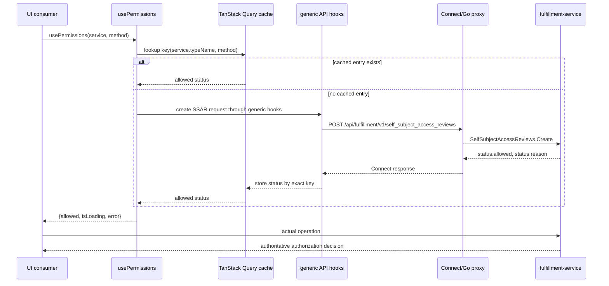

# UI Self-Subject Access Review Permission Hook

| Field       | Value |
|-------------|-------|
| Author(s)   | Rastislav Wagner |
| Jira        | [OSAC-6577](https://redhat.atlassian.net/browse/OSAC-6577), parent [OSAC-4393](https://redhat.atlassian.net/browse/OSAC-4393) |
| PRD         | No PRD is published for OSAC-6577. Requirements are derived from the Jira issues and the existing [OSAC-2476 SSAR design](../../enhancements/OSAC-2476-self-subject-access-review/design.md). |
| Date        | 2026-10-20 |

# 1. Overview

This design defines a reusable `usePermissions` hook for the OSAC UI. The hook
uses the existing `osac.public.v1.SelfSubjectAccessReviews.Create` RPC to
answer whether the authenticated user may perform one public API operation.
Equivalent checks share one in-memory TanStack Query cache entry. For the
lifetime of the browser page session, the first request for a given service/RPC
method identity is cached for the page session. An initial check may make up to
three attempts when the API reports a transient transport failure, while a
full page refresh creates a new cache and service/RPC method identities remain
isolated from one another. [Jira: OSAC-4393] [User]

The hook returns an object with `allowed`, `isLoading`, and `error`. `allowed`
is always boolean: it is `false` while a check is pending or failed, and the
loading/error fields distinguish those states from an actual denial. UI actions
can use the result to expose permission-aware affordances, but the operation
itself remains authoritative because SSAR results are advisory. The design
covers the shared hook and its use of the existing generic API client and
TanStack Query cache; page-by-page adoption is a separate consumer decision.
[API: OSAC-2476] [Codebase:
osac-ui/libs/ui-components/src/api/use-api-query.ts]

# 2. Goals and Non-Goals

## 2.1 Goals

- Provide one typed UI hook for self-subject checks instead of duplicating
  Connect request construction in pages. [Jira: OSAC-4393]
- Cache each distinct service/method check for the browser page session and
  reuse its in-memory result after the initial lookup until the page is
  refreshed. [Jira: OSAC-4393] [User]
- Bypass SSAR checks for private services for the existing Cloud provider admin
  role and return an allowed result immediately. [User]
- Use `CreateButton` as the first representative permission-aware consumer. Its
  create operation requires a generated service descriptor; adding checks to
  other components is follow-up work. [User]
- Keep the hook operation-agnostic so it can support create, read, update, and
  delete checks as later consumers adopt it. [PRD]
- Preserve a distinction between denied, pending, and failed checks so callers
  do not mistake an unavailable check for authorization denial.
- Keep generated protobuf types, transport creation, and cache-key mechanics
  inside reusable `ui-components` hooks. Pages call `usePermissions` instead
  of constructing API requests or cache keys themselves. [Codebase:
  osac-ui/AGENTS.md]

## 2.2 Non-Goals

- No fulfillment-service, protobuf, OPA policy, or HTTP endpoint changes are
  proposed; the design consumes the existing SSAR contract. [API: OSAC-2476]
- No general local role or permission matrix is maintained in the browser. The
  existing `admin` role, labeled “Cloud provider admin,” is one explicit
  bypass because SSAR cannot check private resources. [User] [Codebase:
  osac-ui/libs/ui-components/src/shellTypes.ts]
- No bulk permission-check request is introduced.
- No lifecycle-action wiring is added beyond the first `CreateButton` consumer.
  Start, stop, edit, delete, and other component integrations are follow-up
  work. [User] [PRD]
- No resource-name or tenant-scoped checks are added; the hook exposes only the
  generated service descriptor and method key. The backend’s optional tenant
  field remains available for a future use case.
- No permission logic is added to unrelated presentational primitives;
  `CreateButton` is the explicit permission-aware create-action component.
  [User] [Codebase:
  osac-ui/libs/ui-components/src/components/Primitives/CreateButton.tsx]

# 3. Motivation / Background

The UI already centralizes Connect transport creation and resource hooks, but
it has no shared permission-check abstraction in the current checkout. The
current `CreateButton` is only a visual button/link wrapper, so it cannot
prevent a create action while its permission check is pending or denied. The
parent epic requires a cached SSAR hook, and the requested integration makes
`CreateButton` the first reference permission-aware create-action consumer.
Other create-action call sites and other components can adopt the hook later.
[Jira:
OSAC-4393] [User] [Codebase:
osac-ui/libs/ui-components/src/api/api-context.tsx]

The PRD describes permission checks for create, read, update, and delete
operations, including lifecycle actions such as start, stop, edit, and delete.
This story establishes the operation-agnostic hook and uses `CreateButton` as
the first UI consumer. The lifecycle actions will adopt the same hook in
follow-up work; this design does not claim that all PRD action integrations are
delivered immediately. Tenant- and resource-scoped checks require additional
request/API support and are also future extensions. [PRD] [User]

The permission result is intentionally page-session scoped. After the initial
check and its bounded transient retries, a permission check should not run
again merely because another component mounts, the first component unmounts,
the window regains focus, or the query becomes old; a full browser page refresh
is the reset boundary. [User]

The backend SSAR operation is a create-only, side-effect-free RPC. Its request
describes a public service and method, and its response contains `status.allowed`
and `status.reason`. It is not a persisted resource and must not be modeled as
one in the UI. [API: OSAC-2476]

# 4. Design

## 4.1 Architecture

The implementation has three UI layers, reusing the existing generic API
utilities:

1. `api-context.tsx`, `use-api-query.ts`, and `types.ts` provide the existing
   generic Connect client, TanStack Query wrapper, and typed query-key helper.
   No SSAR-specific API wrapper file is added.
2. `hooks/use-permissions.ts` composes those generic utilities with the
   generated `SelfSubjectAccessReviews` descriptor. It owns SSAR request
   construction, response mapping, and permission-specific query options,
   while the generic utilities perform the API call and caching.
3. `components/Primitives/CreateButton.tsx` owns the first create-action
   integration. It requires a service descriptor, calls `usePermissions` for
   the fixed `create` method key, and controls the button’s disabled state.

The `usePermissions` hook uses `useApiFetch(SelfSubjectAccessReviews)` to get
the generated client and raw TanStack Query `useQuery` to execute and cache
the request. It intentionally does not use the shared `useApiQuery` wrapper or
`apiQueryKey`: permission checks are not resource-route queries, and their
cache identity must include the generated service type name and the resolved
RPC method name. No SSAR route is added to the `ApiRoute` allowlist. [Codebase:
osac-ui/libs/ui-components/src/api/api-context.tsx] [Codebase:
osac-ui/libs/ui-components/src/api/use-api-query.ts]

The proposed public contract is the generated-service-descriptor-based hook:

```ts
import type { DescMethod, DescService } from '@bufbuild/protobuf';

type ServiceMethod<Service extends DescService> = Extract<keyof Service['method'], string>;

type ServiceWithMethod<Method extends string> = Omit<DescService, 'method'> & {
  method: Record<Method, DescMethod>;
};

export interface UsePermissionsResult {
  allowed: boolean;
  error: Error | null;
  isLoading: boolean;
}

export const usePermissions = <Service extends DescService>(
  service: Service,
  method: ServiceMethod<Service>,
): UsePermissionsResult;
```

`CreateButton` requires a generated service descriptor for its fixed `create`
operation while preserving the remaining button props:

```ts
interface CreateButtonProps extends ButtonProps {
  to?: string;
  service: ServiceWithMethod<'create'>;
}
```

`CreateButton` calls `usePermissions(service, 'create')`. The descriptor makes
the service identity and its method keys type-safe; the hook maps the generated
method key `create` to the RPC name `Create` in the SSAR request. It is
therefore used like this:

```tsx
import { BareMetalInstances } from '@osac/types';

<CreateButton
  service={BareMetalInstances}
  to="/bare-metal/create"
>
  Create bare metal instance
</CreateButton>
```

The button is enabled only when `permission.allowed` is `true`. While the
check is loading or denied, it passes `isDisabled={true}` to PatternFly and
must not invoke the click handler or navigate through `to`. The caller’s
existing `isDisabled` value is still honored. When `permission.error` is
non-null, the permission-induced unavailable state uses PatternFly’s
`isAriaDisabled` rather than native `isDisabled`. This preserves the disabled
styling and `aria-disabled="true"` semantics while keeping the button
keyboard-focusable for the error tooltip, including when `to` renders it as a
router link. The error tooltip is attached directly to that focusable button;
PatternFly’s default `aria="describedby"` behavior exposes `error.message`
through the tooltip’s accessible description. The error state must keep
`onClick` and `onKeyPress` inoperable so focus and tooltip events work without
invoking the action or navigating. Loading and denied states remain natively
disabled without an error tooltip. The service-enabled `CreateButton`
integration is the first adoption; other components may adopt
`usePermissions` later. [User] [PatternFly Button](https://www.patternfly.org/components/button#aria-disabled-examples)
[PatternFly Tooltip](https://www.patternfly.org/components/tooltip#props)
[Codebase:
osac-ui/libs/ui-components/src/components/Primitives/CreateButton.tsx]

Because `method` is derived from `keyof Service['method']`, a caller cannot
pass a method key that is not declared by the selected generated service. The
hook does not accept or derive a tenant value: the current use cases require
only service and method. The hook only returns permission state;
`CreateButton` is the adapter that translates that state into a
disabled/enabled button. [User]

Before executing the query, the hook classifies the service descriptor by its
type name. A service under the private API namespace
(`osac.private.v1.*`) cannot be checked through SSAR. For a private service,
the Cloud provider admin role returns
`{ allowed: true, error: null, isLoading: false }` immediately, while every
non-admin role returns
`{ allowed: false, error: null, isLoading: false }`; neither path issues an
SSAR request. Public services execute the SSAR check for every role, including
Cloud provider admins. [User] [Codebase:
osac-ui/libs/ui-components/src/hooks/use-session.tsx]

The permission query uses a custom TanStack Query key rather than an
`ApiRoute` cache namespace. This key does not change the POST endpoint. It
includes the service descriptor’s type name and resolved RPC method name:

```text
[
  "permissions",
  service.typeName,
  rpcMethodName
]
```

The cache belongs to the application’s in-memory `QueryClient`. Configure this
permission query with `staleTime: Infinity` and `gcTime: Infinity`, and disable
automatic refetch on mount, window focus, reconnect, and intervals, and disable
retry-on-mount for an errored cached query. Retry only known transient
transport failures, with at most two retries after the initial attempt. Do not
retry authorization/input failures or malformed responses.
These settings mean that an exact key performs one initial lookup, with at
most three attempts for a transient outage; later consumers read the cached
success or terminal error state for the remainder of that page session. A
full browser refresh recreates the `QueryClient` and starts a new session.
[User] [Codebase: osac-ui/apps/app-frontend/src/main.tsx]

Private-service decisions do not create cache entries because they do not
execute the query. Public-service decisions, including those for Cloud
provider admins, use the normal service/RPC cache key and page-session cache.
[User] [Codebase: osac-ui/libs/ui-components/src/hooks/use-session.tsx]

The `usePermissions` query function creates a public
`SelfSubjectAccessReview` with `spec.service` and `spec.method`, then calls the
generated client’s `create` method through raw `useQuery`. It does not populate
the API’s optional tenant field. It returns the response status and throws when
the response has no object or status. The hook maps the query state to
`{ allowed, isLoading, error }`; because `allowed` is boolean, pending and
error states use `allowed: false` and are distinguished by the other fields.
Request construction, query options, and the permission-specific cache key
stay in `usePermissions`; `useApiFetch` remains the shared client boundary.
[Codebase: osac-ui/libs/ui-components/src/api/use-resource.ts]



The diagram shows that the cache is local to the UI and is populated by the
existing POST RPC. Two consumers with the same key share the one query and
result for the page session; a transient failure may involve bounded retries,
and a later operation still performs its own authorization check. [API:
OSAC-2476] [Codebase:
osac-ui/apps/app-frontend/src/main.tsx]

`CreateButton` is the first permission-aware create-action consumer. Each
instance passes the generated backend service descriptor, while the component
supplies the fixed `create` method key and translates the hook result into
`isDisabled`. Other components may adopt `usePermissions` later. [User]
[Codebase:
osac-ui/libs/ui-components/src/components/Primitives/CreateButton.tsx]

The current SSAR API validates public service names. Storage backends are
currently exposed through a private service in the UI and are used only by the
Cloud provider admin role. Private admin checks return the local allowed result
without calling SSAR, so the hook does not map the private service to an unrelated
public service or require a backend/API decision. [User] [Codebase:
  osac-ui/libs/ui-components/src/api/v1/private/storage-backends.ts]

## 4.2 Data Model / Schema Changes

No persisted schema changes are required. The UI uses generated protobuf
messages only while a check is in flight:

```text
SelfSubjectAccessReview
├── spec.service: string          required public service name
├── spec.method: string           required operation name
└── status
    ├── allowed: boolean          server decision
    └── reason: string            currently empty in the v1 API
```

The generated files under `osac-ui/libs/types` remain unchanged. If the
platform later adds resource-name scope, the proto source and generated
baseline must change before this hook can expose that input. [API: OSAC-2476]

## 4.3 API Changes

The design adds no backend API. It consumes the existing public service:

```http
POST /api/fulfillment/v1/self_subject_access_reviews
Content-Type: application/json
```

Example request:

```json
{
  "spec": {
    "service": "osac.public.v1.VirtualNetworks",
    "method": "Create"
  }
}
```

Example response:

```json
{
  "spec": {
    "service": "osac.public.v1.VirtualNetworks",
    "method": "Create"
  },
  "status": { "allowed": true, "reason": "" }
}
```

The hook translates the generated service descriptor and method key into the
service and method strings sent to the backend. Backend validation remains
authoritative for service and method validity; the type system prevents method
keys that are not declared by the selected descriptor. The API accepts an
authenticated caller’s own permission check and does not accept a user
identity in the request. [API: OSAC-2476]

The generated public descriptor is
`@osac/types`’s `SelfSubjectAccessReviews`; the private SSAR descriptor must not
be used. Private operation descriptors may still be supplied to the hook by
admin-only UI paths, which take the local bypass before constructing an SSAR
request. The Connect layer continues to send public SSAR requests through the existing
`/api/fulfillment` transport. [Codebase:
  osac-ui/libs/types/src/osac/public/v1/self_subject_access_review_service_pb.ts]

## 4.4 Scalability and Performance

- Each unique service-descriptor/RPC-method identity produces one in-memory
  cache entry per `QueryClient` page session. A transient failure can produce
  up to three requests during the initial lookup.
- The query uses `staleTime: Infinity` and `gcTime: Infinity`, with automatic
  refetch on mount, focus, reconnect, and intervals disabled, and retry-on-mount
  disabled for cached errors. A component can unmount and remount without
  causing another permission request.
- Automatic retries are limited to two retries for known transient transport
  failures. Authorization, input, and malformed-response errors are not
  retried, and the result object exposes the cached terminal error until the
  browser page is refreshed.
- There is no database write, browser persistence, or server-side retention.
  The in-memory cache is intentionally cleared when the browser performs a
  full page refresh.
- CPU and memory impact are bounded by the number of distinct permission
  checks rendered during the current UI session. [Codebase:
  osac-ui/apps/app-frontend/src/main.tsx]

## 4.5 Security Considerations

- The request contains only the hypothetical public service and method. It
  contains no user identity; authentication context supplies the subject.
  [API: OSAC-2476]
- The API may return `reason`, but it is not part of the public hook result and
  is not required for the decision. The UI must not construct or display a
  more specific denial reason from client-side data.
- Transport errors are not converted to denial. Treating an outage as
  `allowed: false` would make an availability problem indistinguishable from
  authorization policy.
- The private-service role shortcut is an affordance-only bypass for the UI; it
  does not change backend authorization or make a private operation succeed.
  Public-service admin checks still use SSAR. The actual operation remains
  authoritative. [User]
- The hook only controls affordance visibility. The backend independently
  authorizes the actual operation, so a stale or manipulated client cache does
  not grant access. [API: OSAC-2476]
- Private service descriptors are used only by admin-only UI paths. The Cloud
  provider admin receives the local allowed result, while non-admin users
  receive a local denied result; neither path issues SSAR. Public service
  descriptors use SSAR for all roles. [Codebase: proto/public/osac/public/v1]
  [User]

## 4.6 Failure Handling and Recovery

| Condition | Hook result | Consumer behavior |
|-----------|-------------|-------------------|
| Private service, Cloud provider admin (`admin`) | `{ allowed: true, isLoading: false, error: null }`, no SSAR request | Permission-aware affordance may be shown; the actual operation still performs authorization |
| Private service, non-admin role | `{ allowed: false, isLoading: false, error: null }`, no SSAR request | Keep the permission-aware affordance unavailable |
| Public service, any role | SSAR result `{ allowed, isLoading, error }` | Apply the public-service permission decision |
| API returns `allowed=true` | `{ allowed: true, isLoading: false, error: null }` | Permission-aware affordance may be shown |
| API returns `allowed=false` | `{ allowed: false, isLoading: false, error: null }` | Permission-aware affordance remains unavailable |
| API is loading | `{ allowed: false, isLoading: true, error: null }` | Show loading or unavailable state |
| API returns `InvalidArgument` | `{ allowed: false, isLoading: false, error }` | Keep `CreateButton` in the focusable `isAriaDisabled` state and show `error.message` in its tooltip; do not retry |
| API returns `Unauthenticated` | existing `UnauthorizedError` flow | Redirect or re-authenticate through existing session behavior |
| API or proxy returns a transient error | eventual `{ allowed: false, isLoading: false, error }` if all attempts fail | Retry the initial check at most twice, then keep `CreateButton` in the focusable `isAriaDisabled` state and show the terminal `error.message` in its tooltip until a full page refresh |
| response lacks object or status | `{ allowed: false, isLoading: false, error }` | Treat as an API contract error, keep `CreateButton` in the focusable `isAriaDisabled` state, show `error.message` in its tooltip, and do not retry it |

The RPC is idempotent and side-effect-free, so bounded retries are appropriate
for known transient transport failures. Deterministic authorization, input,
and response-contract failures are not retried. A permission result is not
used as a write precondition; the actual operation must still handle
`PermissionDenied` from the server. [API: OSAC-2476] [User]

## 4.7 RBAC / Tenancy

No roles or backend permissions change. Any authenticated user may call the
SSAR endpoint to check that user’s own permissions, and the backend evaluates
tenant isolation using the same authorization policy as the actual operation.
[API: OSAC-2476]

The hook does not select or pass tenant context. Resource-name and
tenant-scoped checks are therefore unavailable in this UI contract. Private
APIs are admin-only: Cloud provider admins receive the local allowed result and
non-admin users receive the local denied result without an SSAR request. All
public service/method checks, including admin checks, use SSAR.

## 4.8 Extensibility / Future-Proofing

The hook keeps the backend’s service/method vocabulary instead of introducing
a client-only permission enum. New public services and methods therefore use
the same hook without changing its shape. Query-key construction is isolated
in the API hook so a future resource-name field or a bulk-check API can extend
the request and cache identity in one place. The design does not add a global
permission context because TanStack Query already provides shared request
deduplication and page-session cache lifecycle. [Codebase:
  osac-ui/libs/ui-components/src/api/types.ts]

The rollout is intentionally incremental: `CreateButton` is the first
permission-aware consumer, while start, stop, edit, delete, and other
lifecycle actions will use the same hook in follow-up stories. The generic hook
is not limited to the `create` method. Resource-scoped and tenant-scoped checks
remain future extensions because the current request contract does not carry
those inputs. [PRD] [User]

# 5. Interface Changes

The source Jira work has no published PRD, so the mapping uses Jira-derived
requirements `JR-1` through `JR-3` rather than inventing FR/NFR identifiers.

## IC-1: Generic-hook SSAR query integration

**Requirements:** JR-1, JR-2

`usePermissions` builds the public SSAR request, uses the existing
`useApiFetch` client to call `SelfSubjectAccessReviews.Create`, and uses a
permission-specific TanStack Query key containing `service.typeName` and
`rpcMethodName`. The exact key is cached for the lifetime of the page’s
`QueryClient`. No SSAR-specific API wrapper module or `ApiRoute` entry is
added. See §4.1–§4.4 for the request and cache details.

## IC-2: Component-facing `usePermissions` hook

**Requirements:** JR-1, JR-3

`osac-ui/libs/ui-components/src/hooks/use-permissions.ts` exposes
the generic `usePermissions<Service extends DescService>` contract. Its method
parameter is `Extract<keyof Service['method'], string>`, and its result is
`UsePermissionsResult` with `{ allowed: boolean; error: Error | null; isLoading:
boolean }`. It does not accept or derive tenant context, returns `allowed:
false` while loading or after an error, returns the local private-service
decision without SSAR, and executes SSAR for public services regardless of
role. See §4.1 and §4.6.

## IC-3: Permission-aware consumer contract

**Requirements:** JR-1, JR-3

`CreateButton` requires a generated service descriptor exposing the `create`
method and checks that fixed method key through `usePermissions`. It passes
`isDisabled` while the check is loading or denied, and allows the action only
when `allowed === true`. When the hook returns an error, `CreateButton` uses
PatternFly’s `isAriaDisabled` state so the action remains focusable and
exposes `error.message` through a directly attached tooltip; `onClick` and
`onKeyPress` remain inoperable. [PatternFly Button](https://www.patternfly.org/components/button#aria-disabled-examples)
[PatternFly Tooltip](https://www.patternfly.org/components/tooltip#props)
The private-service admin bypass is the explicit exception that enables the
button without SSAR; public-service checks still execute SSAR. `CreateButton`
is the first consumer; other components may adopt the hook later.
Presentational primitives other than `CreateButton` remain unaware of service
names and permission policy. See §4.1, §4.5, and §4.6.

## IC-4: SSAR permission cache key

**Requirements:** JR-2

The permission query uses a custom TanStack Query key containing the hook’s
service type name and resolved RPC method name. It is not an HTTP route or an
`ApiRoute` entry; transport continues to use the generated POST RPC. The entry
remains in memory until the page is refreshed.
See §4.1 and §4.4.

# 6. Alternatives Considered

## Per-component direct SSAR calls

Each page could call `useApiFetch` and `useApiQuery` directly. This keeps the
first implementation local, but duplicates SSAR request construction, loading
and error handling, and permission semantics. The shared `usePermissions`
boundary composed from the generic API utilities is selected. [Codebase:
  osac-ui/libs/ui-components/src/api/use-api-query.ts]

## A global React permission context

A provider could load a permission map and expose it through context. This
would centralize access but would need to know every service/method
combination, would fetch unused checks, and would create a second cache
lifecycle beside TanStack Query. The query cache already shares exact checks,
so a context is rejected. [Codebase:
  osac-ui/libs/ui-components/src/api/use-api-query.ts]

## General client-side role or route matching

The UI could infer every permission from the current role, route, or capability
flags. A general client-side permission matrix is rejected because it would
duplicate backend policy and would drift as policy changes. The one explicit
`admin` bypass is retained
because the existing Cloud provider admin role cannot be checked through the
private-resource SSAR path; all public checks use the backend SSAR decision.
[API: OSAC-2476] [User] [Codebase: osac-ui/libs/ui-components/src/shellTypes.ts]

## Permission logic outside `CreateButton`

Keeping permission logic only in each page would force every create-action
consumer to duplicate the same SSAR call, loading state, and disabled-state
rules. That approach is rejected. `CreateButton` is the explicit component
boundary for create permissions; unrelated presentational primitives remain
policy-unaware. [User] [Codebase:
  osac-ui/libs/ui-components/src/components/Primitives/CreateButton.tsx]

## Browser persistence for permission results

Persisting results in local storage would survive reloads, but the requirement
sets a full page refresh as the reset boundary and local storage could retain
permission decisions on shared browsers. The in-memory QueryClient cache is
selected because it naturally lasts for the page session and is cleared on
refresh. [API: OSAC-2476] [User]

# 7. Observability and Monitoring

No new UI metrics, events, or logs are required. Existing fulfillment-service
gRPC metrics cover the SSAR RPC. The UI should not log permission request
parameters or denial reasons.

# 8. Impact and Compatibility

The change is additive to `osac-ui`: it adds the `usePermissions` hook,
enables the existing Cloud provider admin role bypass, and makes the generated
`service` descriptor required on `CreateButton`. `CreateButton` is the first
consumer; other component integrations are not added in this story. The
permission query uses a
custom cache key because it is not a resource-route query. The change does not
add an SSAR-specific API wrapper or change persisted data, backend APIs,
protobuf sources, or existing resource operations.

The UI build must use a generated `@osac/types` baseline containing the public
SSAR descriptors. Generated files must be advanced through `pnpm gen-types`
only when the selected API baseline intentionally changes; they must not be
hand-edited. A UI deployed against a fulfillment-service version without the
SSAR endpoint will expose a query error and must keep permission-gated actions
unavailable. The permission query’s `QueryClient` must remain alive for the
page session so the one-request guarantee is not lost by recreating the client.
[Codebase: osac-ui/AGENTS.md]

# 9. Decisions

## 9.1 Private API access (Decision)

Private APIs such as `StorageBackends` are admin-only. For a private descriptor,
Cloud provider admins receive
`{ allowed: true, error: null, isLoading: false }` and non-admin users receive
`{ allowed: false, error: null, isLoading: false }`; neither path issues an
SSAR request. Public descriptors use SSAR for all roles. [User]

# 10. Test Plan

The test plan covers the three Jira-derived requirements and all four interface
changes. It tests the reusable `CreateButton` behavior with one representative
service-enabled example, including the focusable `isAriaDisabled` error-tooltip
state. Adding checks to other components is outside this story; lifecycle actions such as
start, stop, edit, and delete are follow-up consumers of the generic hook.
[User] [PRD]

## 10.1 Test Coverage Summary

- **Total test cases:** 12
- **Requirements covered:** 3 of 3 Jira-derived requirements
- **Interface changes covered:** 4 of 4
- **Priorities:** 5 critical, 4 high, 3 medium
- **Automation:** 12 automated, 0 manual

The requirement IDs are Jira-derived because OSAC-6577 has no published PRD
with FR/NFR identifiers. They group observable behavior from OSAC-6577, its
parent epic OSAC-4393, and the existing OSAC-2476 API contract.

## 10.2 Test Cases

### JR-1: The UI exposes a reusable SSAR permission check

#### TC-JR1-01: Allowed public operation is returned by the hook

| Interface Change | Priority | Automation |
|------------------|----------|------------|
| IC-1, IC-2 | critical | automated |

**Preconditions**

- Render a component with `TestProviders` and a mock Connect handler for
  `SelfSubjectAccessReviews.Create`.
- The handler returns an SSAR object with `status.allowed = true` for
  `osac.public.v1.VirtualNetworks` and `Create`.

**Steps**

1. Render `usePermissions(VirtualNetworks, 'create')`, where `VirtualNetworks`
   is the generated `DescService` descriptor.
2. Wait for the query to leave its loading state.

**Expected Results**

- The mock handler receives a create request whose spec contains the exact
  service and method strings.
- The hook returns `{ allowed: true, isLoading: false, error: null }`.

#### TC-JR1-02: Loading, transient retries, and terminal errors remain distinct from denial

| Interface Change | Priority | Automation |
|------------------|----------|------------|
| IC-2, IC-3 | high | automated |

**Preconditions**

- One mock handler delays its response.
- A second mock handler returns `Unavailable` twice, then succeeds, and counts
  calls.
- A third mock handler returns `InvalidArgument` and counts calls.

**Steps**

1. Render the hook against the delayed handler and inspect its initial result.
2. Render the hook against the transient handler and wait for query completion.
3. Render the hook against the terminal-error handler and wait for query
   completion.
4. Remount the terminal-error check in the same QueryClient session.

**Expected Results**

- During the delayed request, the hook returns
  `{ allowed: false, isLoading: true, error: null }`.
- After the transient failures, the hook returns
  `{ allowed: true, isLoading: false, error: null }` and the handler call count
  is three.
- After the terminal error, the hook returns
  `{ allowed: false, isLoading: false, error }`; `isLoading` and `error`
  distinguish the failure from a denied response, and its handler call count
  is one.
- When consumed by `CreateButton`, the terminal error uses the focusable
  `isAriaDisabled` state and the tooltip exposes `error.message`.
- The remount returns the cached terminal error without another request.

### JR-2: Equivalent checks are cached and distinct checks are isolated by service and method

#### TC-JR2-01: Equivalent consumers share one in-flight request and result

| Interface Change | Priority | Automation |
|------------------|----------|------------|
| IC-1, IC-4 | critical | automated |

**Preconditions**

- The mock handler counts calls and returns `allowed = true`.
- A test component renders two hook consumers with the same generated service
  descriptor and method key.

**Steps**

1. Render both consumers at the same time.
2. Wait for both consumers to receive data.

**Expected Results**

- The handler call count is exactly one.
- Both consumers expose the same
  `{ allowed: true, isLoading: false, error: null }` result.

#### TC-JR2-02: Service and RPC method each partition the cache

| Interface Change | Priority | Automation |
|------------------|----------|------------|
| IC-1, IC-4 | critical | automated |

**Preconditions**

- The mock handler returns different decisions for at least two distinct
  service-descriptor/RPC-method identities and records every request.

**Steps**

1. Render checks for the same service descriptor with `create` and `delete`
   method keys, which resolve to distinct `Create` and `Delete` RPC method
   names.
2. Render checks for two different service descriptors with the same `create`
   method key.
3. Wait for all queries to complete.

**Expected Results**

- Each distinct service-descriptor/RPC-method identity produces its own
  request.
- No consumer receives the decision associated with another service or RPC
  method.

#### TC-JR2-03: Page-session cache avoids a second request on remount

| Interface Change | Priority | Automation |
|------------------|----------|------------|
| IC-1, IC-4 | medium | automated |

**Preconditions**

- The test QueryClient allows retries and automatic refetch by default so the
  hook's bounded retry, retry-on-mount, and explicit refetch options are
  exercised.
- The handler returns `allowed = true` and counts calls.

**Steps**

1. Mount the hook and wait for the first response.
2. Unmount and remount the same check during the same QueryClient session.

**Expected Results**

- The second mount displays the cached
  `{ allowed: true, isLoading: false, error: null }` result.
- The handler call count remains one.

### JR-3: Consumers honor service visibility rules and preserve advisory semantics

#### TC-JR3-01: CreateButton is disabled until the Create permission is allowed

| Interface Change | Priority | Automation |
|------------------|----------|------------|
| IC-3 | high | automated |

**Preconditions**

- Render `CreateButton service={BareMetalInstances}`, where
  `BareMetalInstances` is the generated `DescService` descriptor.
- The mock response is delayed and then returns `allowed = true`.

**Steps**

1. Render the `CreateButton`.
2. Inspect the button before the SSAR response.
3. Resolve the handler with `allowed = true` and inspect the button again.

**Expected Results**

- Before the response, the button has `isDisabled === true`.
- After the response, the button has `isDisabled === false` and can invoke its
  create action.

#### TC-JR3-02: A denied Create permission keeps CreateButton disabled

| Interface Change | Priority | Automation |
|------------------|----------|------------|
| IC-3 | high | automated |

**Preconditions**

- The mock SSAR response contains `status.allowed = false`.
- Render `CreateButton service={BareMetalInstances}`.

**Steps**

1. Render the `CreateButton`.
2. Wait for the SSAR request to complete.

**Expected Results**

- The button remains disabled.
- No error tooltip is rendered for the denied response.

#### TC-JR3-03: The actual operation still determines authorization

| Interface Change | Priority | Automation |
|------------------|----------|------------|
| IC-3 | critical | automated |

**Preconditions**

- The SSAR handler first returns `allowed = true`.
- The actual operation handler then returns `PermissionDenied`.

**Steps**

1. Render the consumer and wait until the action is available.
2. Activate the action and execute the actual operation.

**Expected Results**

- The UI sends the actual operation after the positive SSAR result.
- The `PermissionDenied` operation error is surfaced through the existing
  operation error path; the cached SSAR result does not bypass authorization.

#### TC-JR3-04: A public permission-check error surfaces as an error rather than denial

| Interface Change | Priority | Automation |
|------------------|----------|------------|
| IC-1, IC-2 | medium | automated |

**Preconditions**

- `BareMetalInstances` is the valid generated public `DescService` descriptor,
  and `create` is one of its declared method keys.
- The mock `SelfSubjectAccessReviews.Create` handler returns an
  `InvalidArgument` Connect error despite receiving the valid service and
  method request.
- The test renders `CreateButton service={BareMetalInstances}`.

**Steps**

1. Render the service-enabled `CreateButton` with the valid generated
   descriptor and declared `create` method.
2. Wait for the query to settle.

**Expected Results**

- The hook returns `{ allowed: false, isLoading: false, error }`.
- The button uses the focusable `isAriaDisabled` state and its tooltip displays
  `error.message`.
- The consumer does not display the permission-check error as a permission
  denial.
- The mock handler is called once; `InvalidArgument` is not retried.

#### TC-JR3-05: Permission-check errors remain focusable and expose their message accessibly

| Interface Change | Priority | Automation |
|------------------|----------|------------|
| IC-3 | high | automated |

**Preconditions**

- The public-service SSAR handler returns a terminal error with a known
  `error.message`.
- Render `CreateButton service={BareMetalInstances}` with a click handler and,
  separately, with `to="/items/create"`.

**Steps**

1. Wait for the permission check to fail.
2. Move focus to the button with the keyboard.
3. Inspect the button and the PatternFly tooltip’s accessible relationship.
4. Attempt to activate the button and the router-link variant.

**Expected Results**

- The button has `aria-disabled="true"`, retains disabled styling, and remains
  keyboard-focusable; it does not have the native `disabled` attribute.
- The tooltip is attached directly to the button and its `aria-describedby`
  relationship exposes the exact `error.message` to assistive technology.
- Neither the click handler nor router navigation is invoked. The error state
  prevents `onClick` and `onKeyPress` while still allowing focus and tooltip
  events.

#### TC-JR3-06: Cloud provider admin bypasses the SSAR request

| Interface Change | Priority | Automation |
|------------------|----------|------------|
| IC-2, IC-3 | critical | automated |

**Preconditions**

- Render the hook inside a `SessionProvider` with `role="admin"`.
- The mock SSAR handler fails the test if called.

**Steps**

1. Render `CreateButton service={StorageBackends}`.
2. Wait for the button to render.

**Expected Results**

- No SSAR request is sent.
- The button is enabled and the underlying hook result is
  `{ allowed: true, isLoading: false, error: null }`, regardless of the
  private service or method inputs.

#### TC-JR3-07: Non-admin private operation is denied without SSAR

| Interface Change | Priority | Automation |
|------------------|----------|------------|
| IC-2, IC-3 | medium | automated |

**Preconditions**

- Render the hook inside a `SessionProvider` with a non-admin role such as
  `tenant-user`.
- The test renders `CreateButton service={StorageBackends}`.
- The mock SSAR handler fails the test if called.

**Steps**

1. Render the `CreateButton`.
2. Wait for the permission result to settle.

**Expected Results**

- No SSAR request is sent.
- The underlying hook result is
  `{ allowed: false, isLoading: false, error: null }`.
- The button remains disabled without an error tooltip.

## 10.3 Coverage Gaps

All three Jira-derived requirements and all four interface changes are covered.
The admin and non-admin private-service paths are covered by TC-JR3-06 and
TC-JR3-07. Public-service permission checks are covered by the JR-1 and JR-2
cases, and the failed-state accessibility behavior is covered by TC-JR3-05.
No other component integration is expected in this story.

---

## Provenance

Authored: draft @ design 0.11.5 - 1c6e8de, workspace main @ 0034f1eb6
Final: revise @ design 0.11.5 - 1c6e8de, workspace feature/OSAC-6388-ssar-ui @ 0034f1eb6 (dirty)

> Context changed between draft and revise.

<!-- ai-workflow-provenance:{"schema_version":1,"provenance_kind":"session","workflow":"design","workflow_version":"0.11.5","ai_workflows":"1c6e8de","source_repo":"0034f1eb6 (dirty)","source_repo_branch":"feature/OSAC-6388-ssar-ui","commits_behind_main":0,"commits_ahead_main":525,"main_ref":"main","phases":["draft","revise","revise","revise","revise","revise","revise","revise","revise","revise","revise","revise","revise","revise","revise","revise","revise","revise","revise","revise"],"authoring_modes":["skill"],"context_changed":true,"origin_untracked":false} -->
