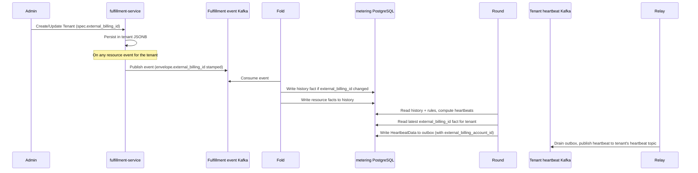

# Tenant External Billing Identity

## Summary

Add an optional, opaque `external_billing_id` to private `TenantSpec`, set through the private Fulfillment API. The fulfillment event publisher stamps the value on every event envelope it publishes for that tenant, and the metering Fold records the latest value as a `history` fact so each `HeartbeatData` the Round publishes carries the external billing account identifier. See [PRD](prd.md) for requirements.

## Motivation

OSAC meters tenant consumption and publishes heartbeats to a per-tenant Kafka topic. Downstream billing adapters route those heartbeats using their own account identifiers, which are unrelated to OSAC tenant names. `TenantSpec` has no field for that identifier, and `HeartbeatData` carries only the OSAC `tenant_id`.

This design stores the identifier on the private tenant. The fulfillment event publisher stamps it on the envelope of every event it publishes for that tenant; the metering Fold reads the envelope field from every event and records the latest value as a `history` fact; the Round carries it into every `HeartbeatData` it writes.

### Goals

- Add optional `external_billing_id` to private `TenantSpec`, set and read through the private Fulfillment API. [Locked: D2]
- Keep the field out of the generated public schema. [PRD: FR-2]
- Set `HeartbeatData.external_billing_account_id` by reading the latest `external_billing_id` fact the Fold writes to `history` from the event envelope. [User]
- Apply billing-id changes to later heartbeats only. [PRD: FR-4]
- Store the field in the existing tenant JSONB document. No SQL migration in fulfillment-service or metering.

### Non-Goals

- Console UI, Enclave Wizard, or CLI changes. The field rides the existing tenant manifest, including `osac create -f`. [Locked: D2, D4]
- More than one external billing account per tenant, or a uniqueness constraint.
- Checking that the identifier exists in the external billing system.
- Rewriting heartbeats already published to the tenant's heartbeat Kafka topic.

## Proposal

Two components change. The private Fulfillment API gains `TenantSpec.external_billing_id`. The event publisher stamps the value on the envelope of every event it publishes for that tenant; the metering Fold reads `event.GetExternalBillingId()` on every event and writes a `history` fact when the value changes; the Round reads the latest fact and sets `HeartbeatData.external_billing_account_id`.

`[(cleanapi.field).private = true]` makes `protoc-gen-cleanapi` omit `TenantSpec.external_billing_id` from the public proto. The publisher performs one lookup per drained batch — collecting distinct tenants, running a single SELECT against `tenants`, and stamping each event — so any event for the tenant carries the current value. The Fold writes a fact only when the value differs from the latest stored one, so `history` does not grow with event volume. The Round reads the latest `external_billing_id` fact for the tenant when it builds each heartbeat. [User]

### Workflow Description

A Cloud Provider Admin sets `spec.external_billing_id` on create or update of a tenant through the private API (`/api/private/v1/tenants`). The field is optional, at most 256 characters, and has no format check. Private Get and List return it when set. Public Get and List do not define it. [Locked: D2, D3]

`PrivateTenantsServer` uses full object replacement: an Update request replaces the entire `TenantSpec`. Omitting `external_billing_id` from an Update request clears the stored value; setting it to a new value stores that value. A caller that wants to preserve the existing value while changing other fields must re-send `external_billing_id` in the request.

After the value is stored, the metering pipeline propagates it to heartbeats:



The publisher already knows each event's tenant (`payloadIdentity`). Before publishing a batch, it collects the batch's distinct tenants, runs one SELECT against `tenants`, and stamps `external_billing_id` on each event's envelope. No join in the write path, no cache, no invalidation problem. The Fold reads `event.GetExternalBillingId()` on every event and writes a `history` fact `(tenant, "Tenant", tenant, "external_billing_id", event_timestamp, value, offset)` only when the value differs from the latest stored one. An empty envelope field signals no billing id is set. The Round reads the latest `external_billing_id` fact for each tenant when it builds a heartbeat and sets `HeartbeatData.external_billing_account_id` when the value is non-empty.

A billing-id change takes effect in the next fold run that processes an event for that tenant. Outbox entries already written by the Round are immutable; the Round does not update them after a billing-id change. The first Round tick after the Fold writes the new `history` fact produces new outbox entries carrying the new id, and the Relay publishes those. Heartbeats already published to the tenant's heartbeat topic stay as they were. [PRD: FR-4]

### API Extensions

- **Private `TenantSpec.external_billing_id`.** Optional string on the existing tenant resource. Create, Update, Get, and List on `/api/private/v1/tenants` gain the field. The public tenant messages are unchanged because `proto/public/` is generated.
- **`Event.external_billing_id`.** Optional string on the shared private `Event` envelope in `proto/private/osac/private/v1/event_type.proto`. The publisher stamps the tenant's current value on every event. Absent when the tenant has none.
- **`HeartbeatData.external_billing_account_id`.** Optional JSON field on the metering heartbeat payload. Present when the latest `external_billing_id` history fact for that tenant is non-empty. Absent when it is not.

## UX Alignment

No UI mapping. The field is private, and console UI is out of scope. [Locked: D2]

### Implementation Details/Notes/Constraints

Add field 3 on `TenantSpec` in `proto/private/osac/private/v1/tenant_type.proto`, after the existing public fields:

```protobuf
message TenantSpec {
  repeated string domains = 1;
  SecretLocalReference break_glass_credentials_secret = 2;

  // Opaque identifier for this tenant's account in the external billing
  // system. Optional. Provider-controlled. Omitted from the public API.
  optional string external_billing_id = 3
    [(cleanapi.field).private = true,
     (buf.validate.field).string.max_len = 256];
}
```

Regenerate with `make -C proto generate` and lint with `buf lint`. Do not edit `proto/public/`.

`PrivateTenantsServer` persists the proto as JSONB through `GenericServer` and `GenericDAO`. No server change and no SQL migration. The public `GenericMapper` copies fields by name; the generated public `TenantSpec` has no `external_billing_id`, so the value is never copied to a public response. The existing protovalidate interceptor enforces the 256-character limit on Create and Update.

Two fulfillment files change beyond the proto:

**`proto/private/osac/private/v1/event_type.proto`** — add an optional `external_billing_id` envelope field to the shared `Event` message (alongside `id`, `timestamp`, etc.). Regenerate with `make -C proto generate`.

**`fulfillment-service/internal/servers/event_publisher.go`** — in the drain loop, before publishing each batch, collect the batch's distinct tenants, run one SELECT against `tenants` to read `spec.external_billing_id` for each, and stamp the field on the `Event` envelope. No trigger change and no join in the database write path. `redactEvent` does not touch the envelope field.

In metering, changes touch two files. No schema migration is needed: the `history` table already has the right shape (`tenant`, `resource_type`, `resource_id`, `field`, `since`, `value`, `event_offset`) and the `progress` table is unchanged.

**`osac-metering/metering-service/internal/fold/facts.go`** — on every event, read `event.GetExternalBillingId()` from the envelope and write a `history` fact `(tenant, "Tenant", tenant, "external_billing_id", event_timestamp, value, offset)` only when the value differs from the latest stored one. An empty envelope field writes an empty value, signaling no billing id is set. No payload type check, no special case for tenant events. The same idempotency guarantee applies: replaying the event topic produces the same facts. No metering annotation is added to the proto; `external_billing_id` is not a billing meter field and does not go through the `metering.Resources()` registry.

**`osac-metering/schema/heartbeat.go`** — add the field to `HeartbeatData`:

```go
ExternalBillingAccountID *string `json:"external_billing_account_id,omitempty"`
```

The Round reads the latest `external_billing_id` fact for each tenant from `history` (the row with the maximum `since` for `resource_type = "Tenant"`, `resource_id = tenant`, `field = "external_billing_id"`) and passes it to the heartbeat builder (`heartbeat/event.go`). The builder sets `data.ExternalBillingAccountID` when the value is non-empty.

The field is carried on `HeartbeatData` and published to the tenant's heartbeat topic, where an adapter for a billing system that needs the OSAC→account mapping can read it. It is deliberately excluded from `heartbeatDataFields`, so the m360 adapter — which maintains its own account mapping — never receives it. `schema/heartbeat_test.go`'s field-list assertion is widened to skip it, alongside `usage` and `billing_dimensions`.

### Security Considerations

The private annotation is the access boundary. Public clients have no field to send or receive. The value is an account reference with the same sensitivity as the tenant name, and the only new validation is the 256-character limit. [PRD: FR-2]

### Failure Handling and Recovery

A value longer than 256 characters is rejected on Create and Update. Omitting the field on Update clears the stored value; subsequent events carry an empty envelope field, the Fold writes an empty-value fact, and subsequent heartbeats omit `external_billing_account_id`. If no event has been consumed yet (first boot or replay from an empty topic), no `external_billing_id` fact exists and heartbeats omit the field until the first event arrives. A changed id is a new fact with a new `since` timestamp, so FR-4 (changes apply going forward) falls out naturally; heartbeats already published stay as they were. [PRD: FR-4]

### RBAC / Tenancy

No new RBAC. Cloud Provider Admins use the private Tenant API. The public schema omits the field.

### Observability and Monitoring

No new metrics or alerts. [Locked: D3] No new log lines. The field flows through the existing pipeline without additional failure paths.

### Risks and Mitigations

The new JSON key is omitted when unset, so existing adapters ignore it. m360 never receives it because the field is excluded from `heartbeatDataFields`.

**In-place upgrade gap and retention edge:** Because the publisher stamps `external_billing_id` on every event, any event after upgrade carries the current id and the newest retained event always carries the newest id. A replay from any retained offset converges to the current value. No no-op Update is required. Operators may issue one as a convenience to surface the id sooner on a quiet tenant.

### Drawbacks

The publisher performs one extra SELECT per drained batch. Metering retains its existing two-dependency model (Kafka and PostgreSQL) and the rebuild-from-Kafka invariant.

## Alternatives (Not Implemented)

| Decision | Alternative | Why it was rejected |
|----------|-------------|---------------------|
| Enrich in metering Fold | Each adapter calls the private Tenant API | Adapters for billing systems without an existing OSAC integration can read the field directly from the heartbeat topic. Adapters such as m360 that already maintain their own OSAC→account mapping exclude the field and are unaffected. Pushing the lookup into every adapter duplicates the credential and API connection requirements. |
| Field on `HeartbeatData` | CloudEvent extension attribute only | Receivers are not required to forward extension attributes, so a broker can strip the id. Adapters already read `HeartbeatData`. |
| Private spec field | `metadata.labels` entry | Labels are on the public API and are caller-writable, which breaks FR-2. |
| Publisher-stamped envelope (chosen) | Fold calls `TenantsClient.Get` on each fold run | The API-call approach adds the first runtime dependency from metering to fulfillment (credentials, gRPC client, failure path) and breaks the rebuild-from-Kafka invariant. |
| Publisher-stamped envelope (chosen) | Tenant-events-only (read `spec.external_billing_id` from Tenant payload) | Zero fulfillment code, but the id refreshes only on tenant writes, leaving an in-place upgrade gap and a Kafka retention edge for quiet tenants. The publisher-stamped approach eliminates both at the cost of one contained fulfillment change. |

## Test Plan

Test the private field and the heartbeat payload together. Create and update a tenant with and without `external_billing_id` on the private API, and confirm a public Get omits it. Assert the publisher stamps the correct `external_billing_id` on event envelopes for that tenant and omits it when the tenant has none. Publish events to the Fold and confirm the `history` table holds the correct `external_billing_id` fact when the envelope value changes, and does not grow when the value is unchanged. Confirm the Round sets `HeartbeatData.external_billing_account_id` from the latest history fact when non-empty and omits it when empty or absent. Confirm the m360 payload contains no `external_billing_account_id` even when the tenant has a billing id set. A value longer than 256 characters is rejected.

Update semantics: confirm that omitting `external_billing_id` from an Update request clears the stored value (subsequent Get returns no field; subsequent heartbeats omit `external_billing_account_id`). Confirm that a caller who sends the same value on Update preserves it. Confirm that a caller who changes the value on Update stores the new value and that the next fold run propagates it.

End-to-end coverage (belongs in the mono-repo's `tests/e2e/` as [QE] work): happy path — create a tenant with `external_billing_id` via the private API, provision one billable resource, consume the tenant's heartbeat topic, and assert an arriving heartbeat carries `external_billing_account_id` equal to the set value; negative path — create a tenant without the field, verify heartbeats omit it; change path (FR-4) — update the tenant's id, verify heartbeats published after the change carry the new id and that heartbeats already on the topic are unchanged.

## Graduation Criteria

Not targeted at a release yet.

## Upgrade / Downgrade Strategy

The field is optional. Upgrade needs no migration in fulfillment-service. Downgrade leaves the value in the tenant JSONB document and omits it from the API and from new heartbeats. The stored value is still there after a later upgrade.

## Version Skew Strategy

An older fulfillment-service ignores the field on input and omits it on output. An older metering build omits `HeartbeatData.external_billing_account_id`. If metering is upgraded first, event envelopes carry no `external_billing_id` until fulfillment-service is upgraded, and heartbeats published in that window omit the field.

## Support Procedures

If heartbeats for a tenant lack `external_billing_account_id`, read the tenant on the private API and confirm `external_billing_id` is set. If it is set but heartbeats still omit the field, no event for that tenant has been published and folded since the id was stored. The next event of any kind carries the current id on its envelope. Heartbeats already published are not replayed.

## Infrastructure Needed

None.

---

## Provenance

Authored: revise @ design 0.11.5 - a58bdf7, workspace main @ f0a8211
Phases: draft, revise, revise, revise, revise

<!-- ai-workflow-provenance:{"schema_version":1,"provenance_kind":"session","workflow":"design","workflow_version":"0.11.5","ai_workflows":"a58bdf7","source_repo":"f0a8211","source_repo_branch":"main","commits_behind_main":0,"commits_ahead_main":0,"main_ref":"main","phases":["draft","revise","revise","revise","revise"],"authoring_modes":["skill"],"context_changed":false,"origin_untracked":false} -->
